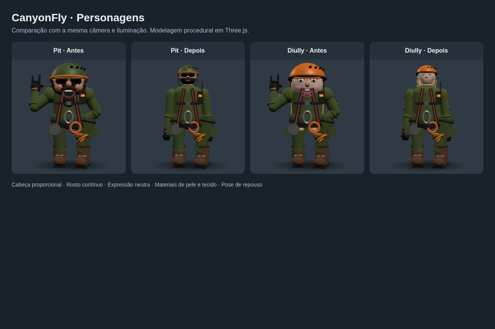
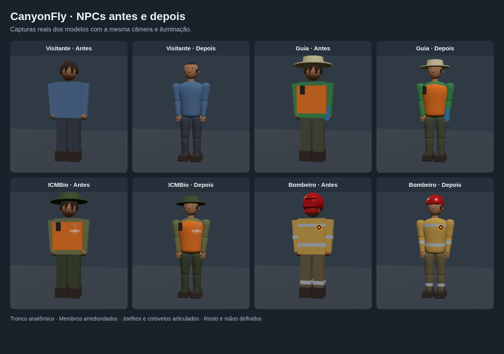
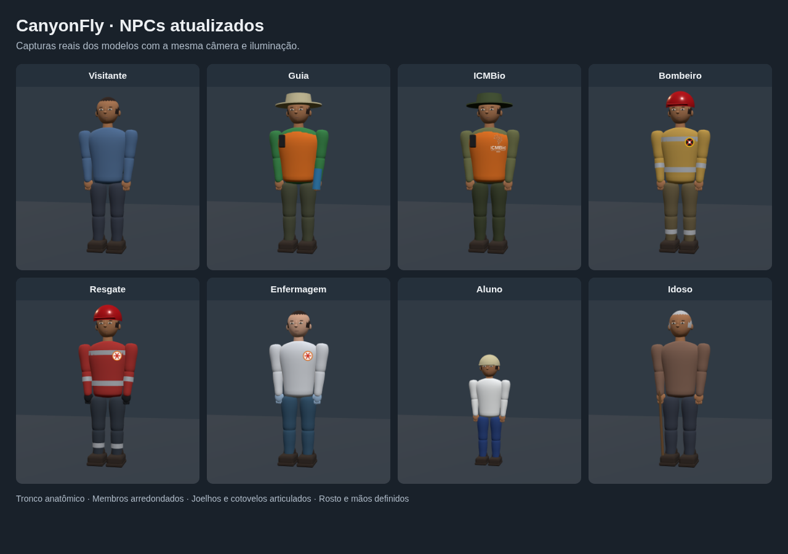

# Aparência dos personagens

A base comum agora usa proporções mais próximas de um adulto, rosto contínuo com mandíbula definida, olhos com pálpebras e boca fechada. A pose inicial é de repouso. As animações continuam usando os mesmos grupos de ombros, cotovelos, mãos, quadris e joelhos.

O estilo continua sendo 3D procedural, com acabamento semirrealista. A mudança abrange Pit, os operadores, os NPCs que usam a base comum e os personagens especiais.

## Organização

- `t3d/src/mundo/personagens/rosto.js`: contorno da cabeça e barba, olhos, nariz, orelhas, boca e materiais de pele. A cor parte da pele de cada personagem.
- `t3d/src/trolley3d.js`: proporções da base, mãos, pose inicial, tecidos e encaixes do equipamento.
- `t3d/src/mundo/personagens/modelos.js`: cabelos, tranças, piscar e acessórios das formas de poder.
- `t3d/src/mundo/poderes/pit.js`: visor da armadura acompanha a posição e escala da cabeça.

As operadoras usam referências explícitas aos grupos dos olhos, sem procurar malhas pela ordem dos filhos. Capacetes e adereços da cabeça compartilham a escala correspondente. A trama mantém `roughness = .92` para continuar compatível com a transformação das roupas.

## Verificação

Execute `npm ci`, `npm test` e `npm run build` dentro de `t3d/`. O bundle em `t3d/dist/` acompanha o código-fonte, pois a página principal o carrega diretamente.

Os testes verificam superfícies e normais da cabeça/barba, preservação dos tons de pele e isolamento dos materiais. A revisão no Chromium inclui retratos de frente e perfil dos 11 personagens e ativação/desativação dos efeitos das formas de poder.

No jogo completo, foram verificadas a troca entre Pit, Sepé, Tupã e Atiara, caminhada/corrida, matrizes das articulações sem valores inválidos e restauração das cores após a transformação dos operadores. Não houve erros de JavaScript nesse percurso.

## NPCs das multidões e da praça

Visitantes, guias, professores, alunos/crianças, idosos, agentes do ICMBio, bombeiros, resgatistas, enfermagem, vítimas/acompanhantes e pedestres da praça compartilham agora uma segunda base anatômica instanciada. Tronco, colete, coxas, canelas, braços e antebraços usam perfis elípticos suaves; botas e mochilas têm bordas arredondadas. Os rostos têm mandíbula, nariz, orelhas, olhos e boca. As crianças recebem uma cabeça proporcionalmente maior.

A base fica em `t3d/src/mundo/gente/geometrias.js`, e as matrizes das articulações e dos acessórios são montadas em `gente/pessoas.js`. O pool e o desenho por `InstancedMesh` continuam compartilhados; a geometria não é criada por pessoa ou por quadro. Mesmo à distância, braços e pernas continuam visíveis; detalhes pequenos do rosto são omitidos. As peças adicionais continuam recebendo as cores e os uniformes de cada função.

Verificação adicional: testes de geometria, normais, altura das botas e atributos de cor; Chromium com oito perfis de NPC, poses de repouso, caminhada, sentado, deitado, foto e prancheta, além da versão distante sem detalhes faciais.

No teste integrado do jogo completo, foram verificados 32 NPCs ativos, incluindo nove pessoas de serviço no cenário de descida do resgate. As matrizes das instâncias permaneceram válidas e dentro da capacidade dos lotes, com canelas, antebraços e rostos presentes e sem erros de JavaScript.
