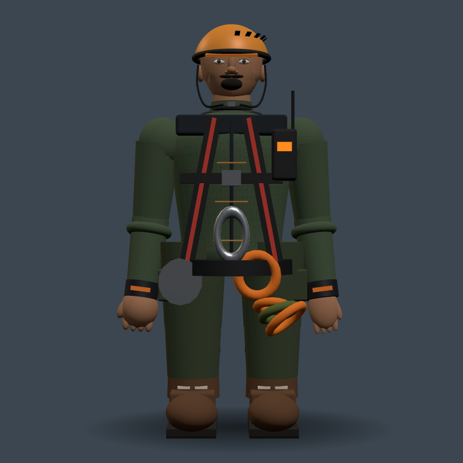
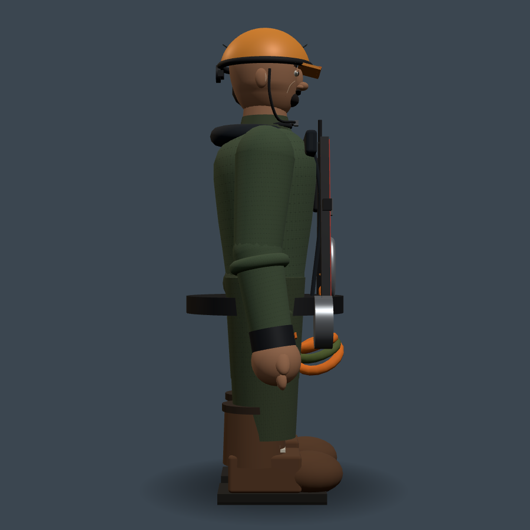
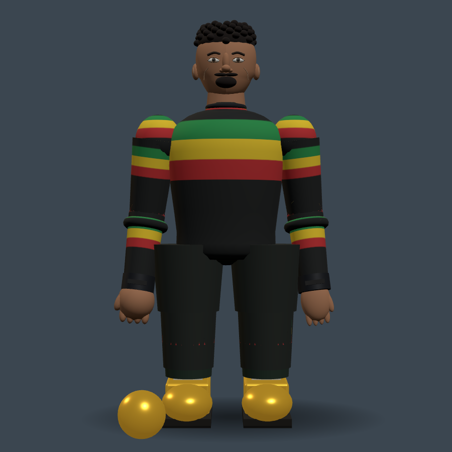
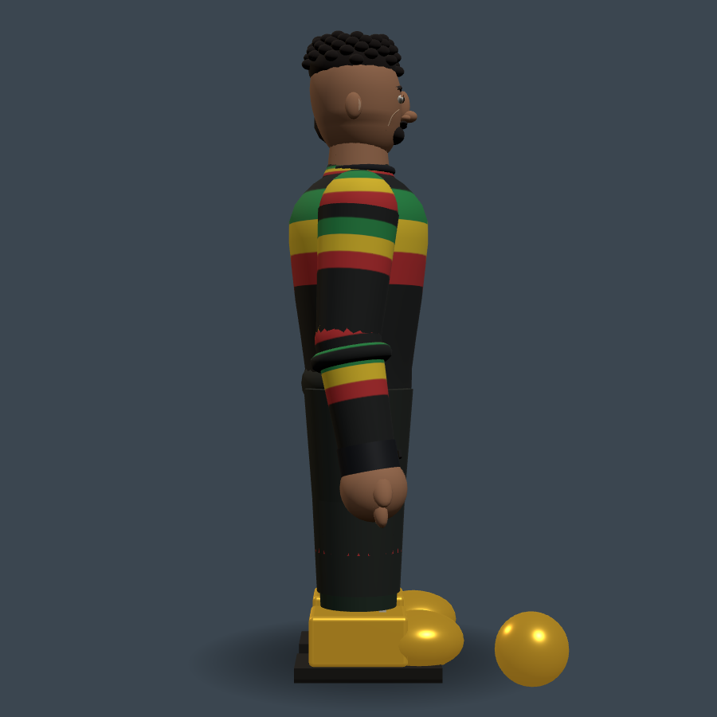

# Carlão — Reggae

Modelo 3D procedural, com acabamento estilizado: pele mais morena nas duas formas (`0x9e6e4e`), cabelo preto crespo, cavanhaque, rosto próprio e uniforme verde da equipe da tirolesa. Na transformação automática, camisa com faixas preta/vermelha/amarela/verde, calça de treino, meião com faixas e chuteiras douradas emissivas. Bola dourada junto ao pé com rastro de partículas no chute.

## Login

Placeholder próprio `carlao` em `data/seguranca/senhas.js`. Preencher salt e hash PBKDF2-SHA256, 100000 iterações, usando o gerador local `tools/gerar-hash.html`. Campos vazios bloqueiam produção. `teste.carlao` usa a credencial debug existente, limitada a localhost ou modo debug; não foi criada senha em texto claro.

## Comandos

| Ação | Mouse/teclado | Controle |
|---|---|---|
| Chute que volta | Clique rápido / toque rápido em V | Toque rápido em R2 |
| Bola que explode | Segurar e soltar clique ou V | Segurar e soltar R2 |
| Capoeira | Q | R1 |
| Rasteira | F | Triângulo |

O limiar de carga é 0,35 s. `data/poderes.js` permite `modoBola: 'carga'`, `'volta'` ou `'explode'`. No impacto explosivo, a bola reaparece no pé no mesmo quadro; o estoque é infinito. No toque, a bola retorna ao jogador e libera o chute seguinte. A colisão contínua verifica o trajeto entre quadros e só atinge hostis. Explosão e capoeira preservam civis e animais.

Capoeira usa animação procedural articulada, aplicada depois da pose da caminhada: ginga, meia-lua de compasso, martelo e armada, com quadris, joelhos, braços, inclinação e giro. Não é captura de movimento. A rasteira usa pose baixa, derruba hostis por quatro segundos e atordoa animais sem tirar vida. A postura original dos alvos é restaurada ao terminar ou sair da transformação.

O campo da Vila Ouro Verde tem dois operários e pontos de conversa. Com Carlão selecionado, eles comentam a bola dourada e combinam uma partida depois do turno. Os pontos são removidos quando a vila é descarregada.

## Validação

16 testes unitários passaram, incluindo PBKDF2 próprio e bloqueio do login de teste em produção. Cinco cenários de navegador cobrem retorno/encadeamento, explosão e reposição no mesmo quadro, modo fixo configurável, proteção de civis, rasteira, restauração, mouse/arrasto, Q/F, controle e tempo parado. Regressão dos 11 personagens passou sem erros JavaScript.

No bundle completo: transformação exige sessão e época; pele mantém o mesmo tom; os dois chutes atingem o alvo; as quatro poses movem as pernas; a rasteira não tira vida; a forma normal é restaurada; matrizes finitas. A Vila Ouro Verde real do KML foi carregada e o diálogo dos dois operários foi verificado.

## Prints do jogo

| Forma | Frente | Perfil |
|---|---|---|
| Normal |  |  |
| Poder |  |  |
