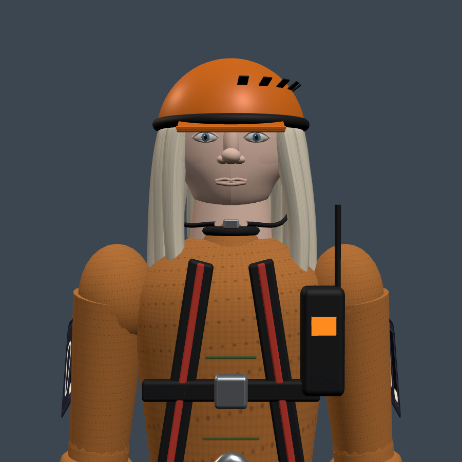
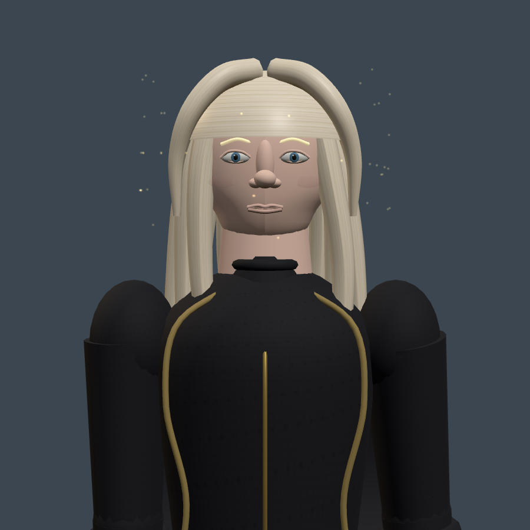
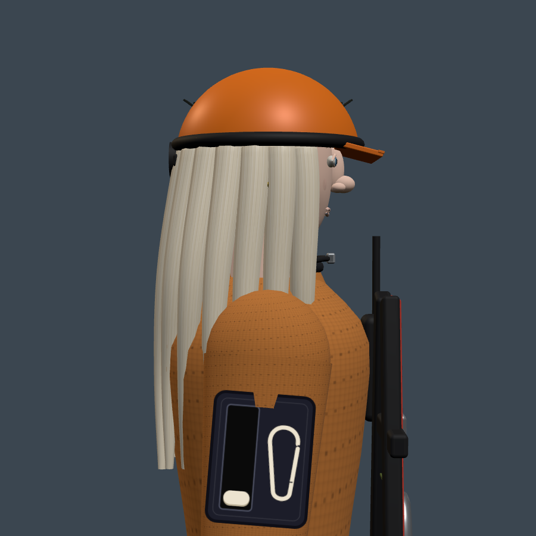
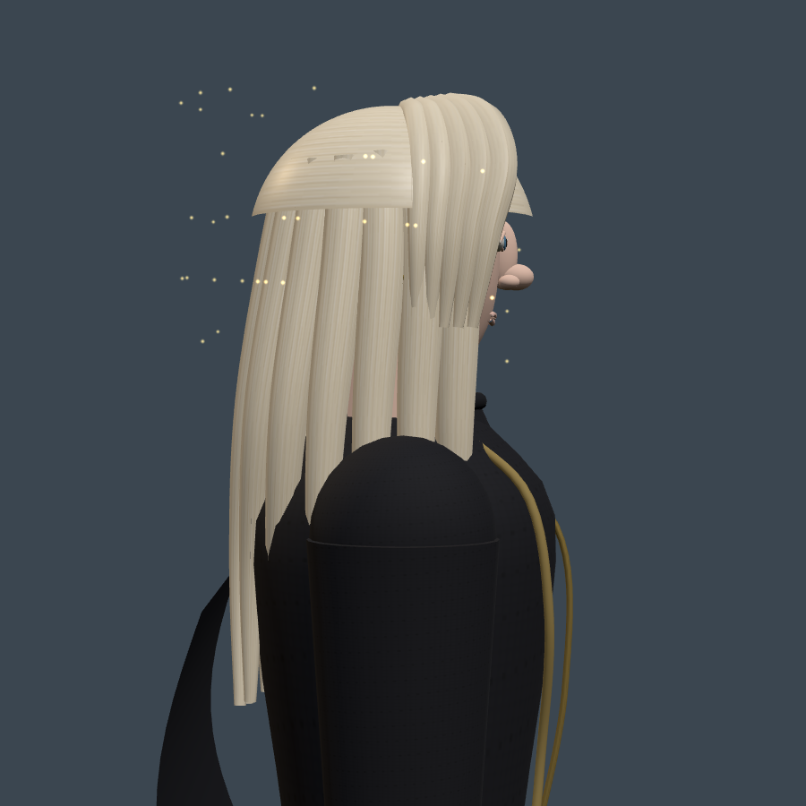
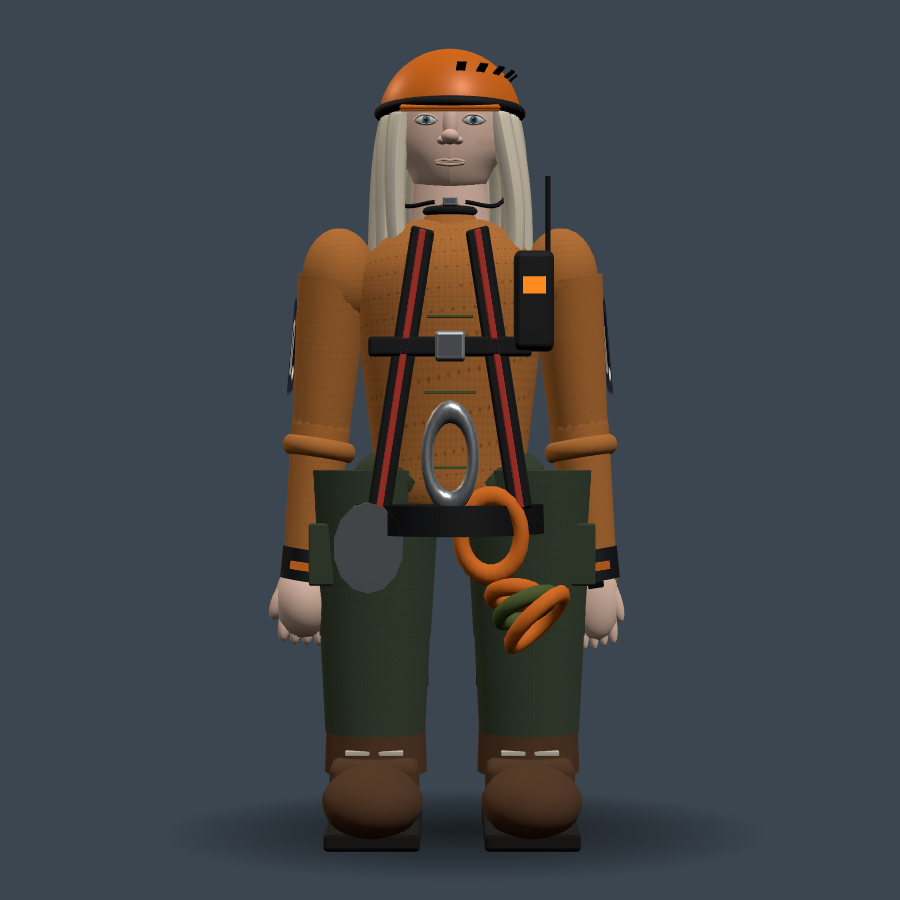
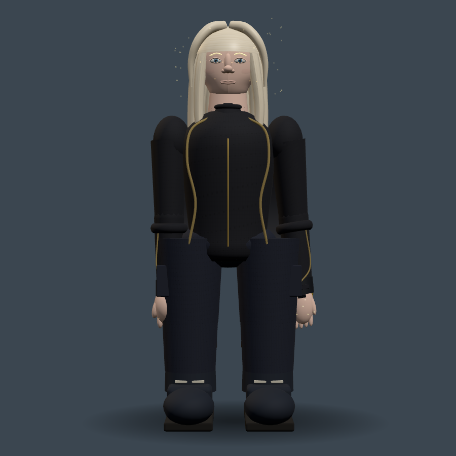

# Diully

Modelo procedural no jogo, com acabamento estilizado (não fotográfico): mulher adulta, cabelo loiro longo com textura de fibras, pele e olhos próprios, maquiagem discreta e acessórios dourados. Uniforme laranja/verde com capacete e equipamento de tirolesa. Na transformação automática de 1950, jaqueta preta fechada, calça escura, detalhes dourados, cabelo e roupa com brisa e partículas douradas.

Flutua a **2 m acima do chão real**. O movimento e a câmera acompanham essa altura, sem somar salto. Animações de ajeitar o cabelo e acenar durante repouso; selfie com celular apenas perto dos mirantes identificados ou do mirante do lançamento. Não interrompem corrida ou poderes.

## Login

`diully` possui placeholder próprio em `data/seguranca/senhas.js`. Preencher salt e hash PBKDF2-SHA256, 100000 iterações, usando `tools/gerar-hash.html` ou `tools/gerar_hash.mjs`. Campos vazios bloqueiam produção. `teste.diully` usa somente a credencial de debug já configurada; não foi criada senha em texto claro.

## Poderes e comandos

| Ação | Mouse / teclado | Controle |
|---|---|---|
| Erguer e segurar | Manter botão direito | Manter L2 |
| Arremessar o alvo segurado | Clique | R2 |
| Bater no chão | Q | R1 |
| Conversar usando Lábia | E | L1 |

V e o botão de poder na tela também alternam erguer/arremessar. A carga aumenta a força; soltar o botão de segurar devolve o alvo ao chão sem dano. Arremessos usam gravidade, impacto e restauração da IA; trocar de personagem ou época libera alvos e fecha diálogos. Objetos móveis não recebem dano. Criaturas sobrenaturais não aceitam Lábia.

A Lábia mostra escolhas e chance configurável (`data/poderes.js`, 65% inicialmente). Sucesso faz o humano desistir; a opção de ajudar também o marca como aliado. Recusa do callback é respeitada. Falhas e sucessos emitem `poder:labia` com o resultado efetivo. Humanos desistentes deixam de ser hostis e não executam o comportamento de combate.

Para atores humanos das missões: registrar em `M.poderes` com `tipo:'pessoa'` ou `tipo:'inimigo', humano:true`, `pos()` e callback opcional `aoLabia({escolha})`. A história da Atiara continua marcada como **em breve** nos dados atuais; esta entrega prepara o poder/evento, sem apresentar essa missão como implementada.

Objetos carregáveis são registrados com `M.poderes.diully.registraObjeto(grupo, nome, id)` e removidos com `removeObjeto(alvo)`. A área de treino debug tem duas caixas móveis e o visitante para testar os poderes. Construções e árvores não são objetos carregáveis.

## Validação

14 testes unitários passaram, incluindo credencial própria e bloqueio do login debug em produção. Sete cenários de navegador da Diully: inimigos, objetos, diálogo com sucesso/falha/veto/cancelamento, restauração ao trocar de personagem, mouse/clique/arrasto, gamepad e tempo parado. Regressão dos 11 personagens e testes da Mary passaram.

No bundle completo: transformação exige login e época antiga; altura medida em 1,999923 m no chão real; telecinese, queda e Lábia com visitante; três gestos; retorno ao uniforme; matrizes finitas. Capturas abaixo são renders do código do jogo, não imagens conceituais.

## Capturas para aprovação

| Vista | Forma normal | Forma de poder |
|---|---|---|
| Frente |  |  |
| Perfil |  |  |
| Corpo inteiro |  |  |
