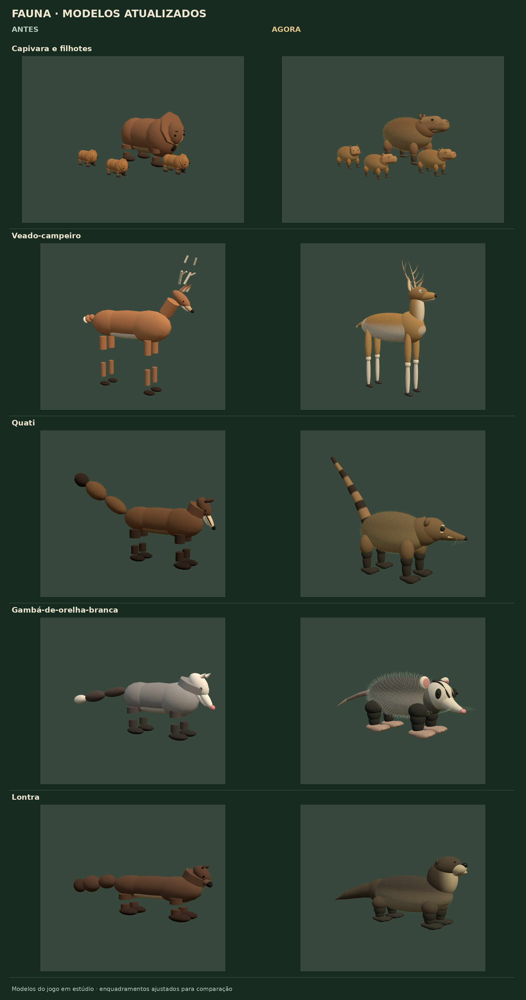

# Capivaras, veado-campeiro, quati, gambá e lontra

Os modelos receberam anatomia própria baseada nas fotografias enviadas. Usam superfícies curvas, materiais por animal, microtextura procedural e fibras de pelo, mantendo o estilo visual do jogo. As aparições do parque e dos anos 1950 usam os mesmos novos modelos.

- **Capivara adulta e três filhotes:** corpo robusto, focinho largo, olhos e narinas altos, orelhas pequenas, patas com quatro dedos na frente e três atrás e corpo sem cauda externa visível. Os filhotes têm proporção de cabeça e tamanho próprios. A família mantém caminhada, pastagem, repouso, água, fuga e reencontro. A posição do plano de recorte em terra foi corrigida para manter os animais visíveis; o recorte abaixo da água alcança também pelo e bigodes. Foram preservados o escurecimento do pelo molhado e a transição de altura ao nadar e mergulhar.
- **Veado-campeiro:** pernas finas, cascos divididos, pescoço esguio, ventre claro, área branca na parte traseira, orelhas grandes e duas galhadas com três pontas cada.
- **Quati:** corpo arqueado, focinho alongado, marcas claras e escuras na face, cinco dedos com garras e cauda comprida com anéis e articulações contínuas.
- **Gambá-de-orelha-branca:** pelagem grisalha com fibras claras, face creme com faixas escuras, orelhas claras com interior rosado, nariz rosa, dedos e cauda afilada sem textura de pelos.
- **Lontra:** corpo alongado, cauda muscular e afilada, patas palmadas, orelhas pequenas, focinho curto, bigodes e coloração clara no peito e ao redor da boca.

## Vistas individuais

| Animal | Frente / família | Perfil | Outra vista |
|---|---|---|---|
| Capivara | [Família](media/capivaras/capivara-familia.png) | [Adulta](media/capivaras/capivara-adulta-perfil.png) | [Filhote](media/capivaras/capivara-filhote.png) |
| Veado-campeiro | [Frente](media/veado/veado-frente.png) | [Perfil](media/veado/veado-perfil.png) | [Parte traseira](media/veado/veado-costas.png) |
| Quati | [Frente](media/quati/quati-frente.png) | [Perfil](media/quati/quati-perfil.png) | [Três quartos](media/quati/quati-tres-quartos.png) |
| Gambá | [Frente](media/gamba/gamba-frente.png) | [Perfil](media/gamba/gamba-perfil.png) | [Três quartos](media/gamba/gamba-tres-quartos.png) |
| Lontra | [Frente](media/lontra/lontra-frente.png) | [Perfil](media/lontra/lontra-perfil.png) | [Três quartos](media/lontra/lontra-tres-quartos.png) |

As capturas usam os modelos reais em estúdio. O enquadramento é ajustado por modelo e não compara tamanhos absolutos. As imagens anteriores usam a geometria e as poses anteriores à atualização.

## Verificação

Build do bundle e 38 testes automatizados, incluindo pés apoiados, geometrias finitas, materiais isolados, galhadas, caudas, descarte de recursos, marcha, farejamento, alerta, fuga e reflexo noturno. Os testes de navegador exercitam as classes reais de animais e verificam as capturas.

- `npm --prefix t3d test`
- `npm --prefix t3d run build`
- `node t3d/test/browser/capivaras.cjs`: poses, nado, imersão, recorte de todos os materiais, pelo molhado, retorno à terra e visibilidade no renderizador.
- `node t3d/test/browser/fauna-natural.cjs`: quatro espécies, poses, alerta, fuga e capturas.
- `node t3d/test/browser/fauna-natural-game.cjs`: integração dos quatro modelos no bundle e no gerenciador do mundo, animação e remoção.

Os testes de navegador usam Playwright e aceitam `PLAYWRIGHT_CHROMIUM_EXECUTABLE`. O teste no mundo requer servidor HTTP na raiz, configurável por `FAUNA_GAME_URL` (padrão porta 8043).
