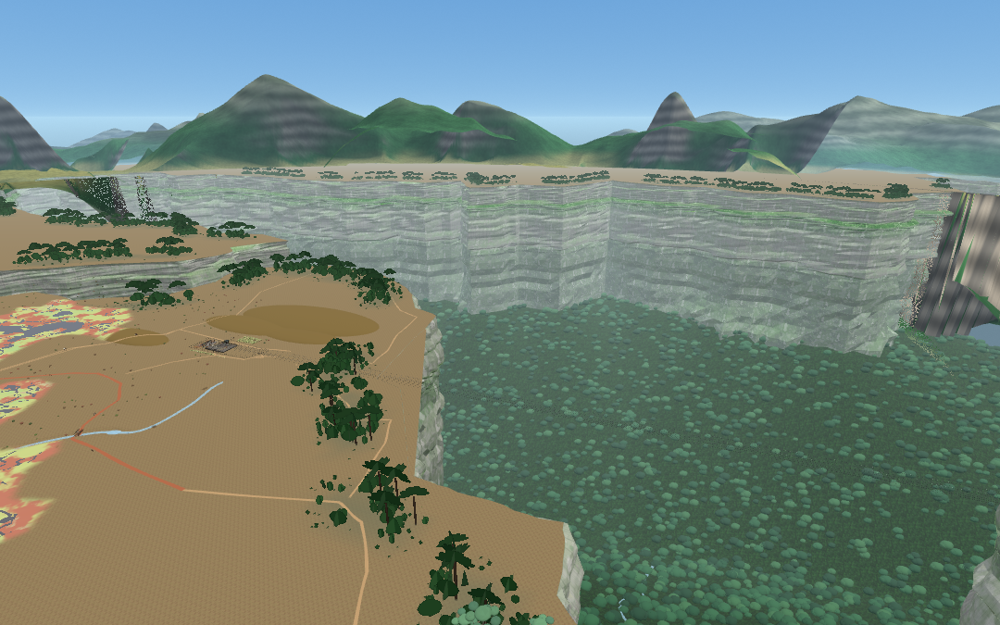
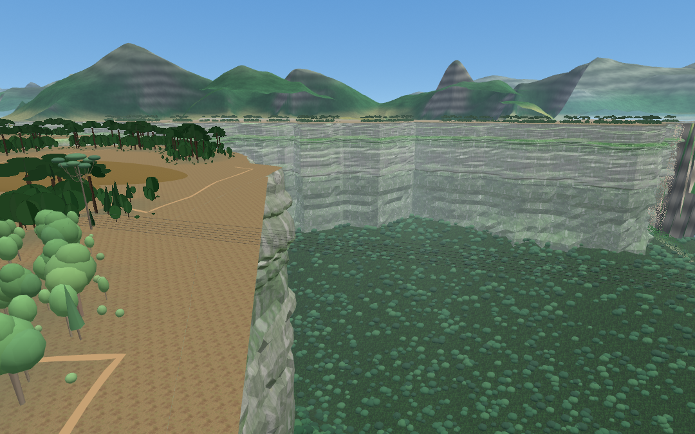
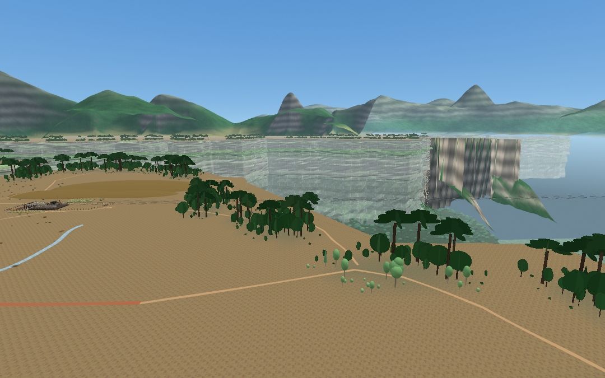
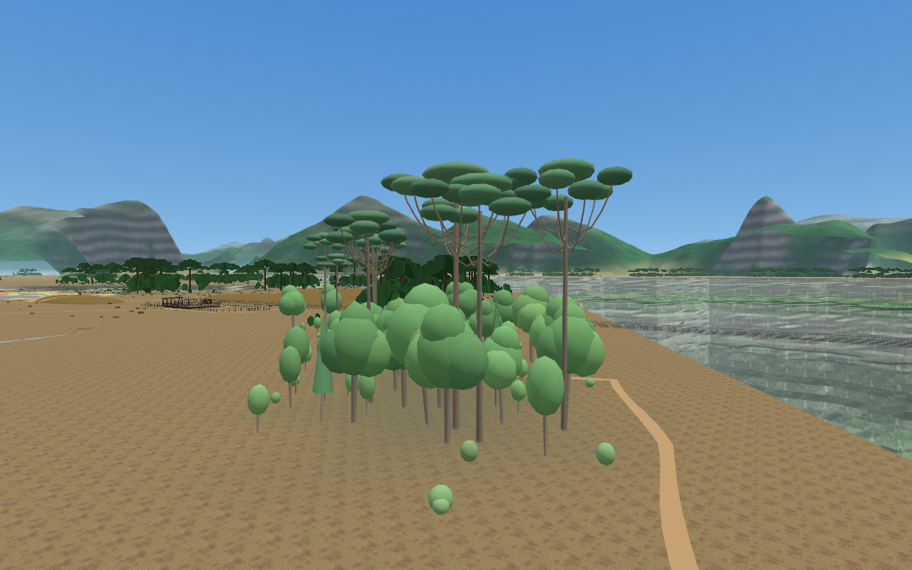

# Cânion Fortaleza — paredes e Floresta Ombrófila Mista

Atualização visual inspirada na referência enviada, preservando o traçado georreferenciado do cânion, trilhas, rio e áreas construídas.

## Paredões

Fraturas verticais mais contínuas, colunas e reentrâncias no relevo, contatos entre derrames, mapa de normais mais definido e variação de basalto exposto, umidade e líquens. Faces com iluminação mais angular reduzem o aspecto arredondado. O primeiro anel da parede permanece preso à linha da borda, sem afastar a rocha do topo do platô.

## Mata no topo

Araucárias emergentes de 24–36 m, com tronco alto, galhos curvos ascendentes em candelabro e copa larga e achatada. Acompanhadas de folhosas de 12–19 m, podocarpos, árvores médias e sub-bosque. Copas sólidas com contorno mais suave e variações de porte/cor; a vegetação deixa de depender de grandes formas geométricas facetadas.

As áreas de mata do KML são complementadas por capões irregulares junto às duas bordas. Os intervalos preservam campos abertos. A seleção de pontos continua respeitando terra firme, trilhas, estacionamento, cercado, água e turfeiras. O platô norte agora é elegível para árvores, com as raízes apoiadas na altura do seu topo. Não são plantadas árvores dentro do vão.

O nível de detalhe distante foi ampliado para a mata da margem oposta continuar visível. Geometria sólida perto e silhuetas distantes usam instâncias. A floresta das encostas ganhou copas compostas e distribuição mais cheia, em verdes mais profundos.

Trata-se de uma representação procedural e estilizada da formação florestal, não de um inventário botânico ou reconstrução fotográfica.

## Verificação

25 testes unitários passaram: linha superior do paredão ancorada, fraturas determinísticas, geometria/normais válidas, araucárias maiores que o restante da mata, níveis de detalhe, elegibilidade e altura das raízes nas duas margens, capões determinísticos dentro de terra firme e intervalos de campo preservados.

No bundle completo, quatro vistas foram renderizadas pelo motor do jogo. Árvores confirmadas nas duas margens, incluindo milhares de instâncias no platô norte; araucárias presentes em todos os cenários. Sem erros JavaScript ou erros de compilação dos shaders detectados. A quantidade exata varia conforme qualidade e distribuição da vegetação.

## Capturas do jogo

