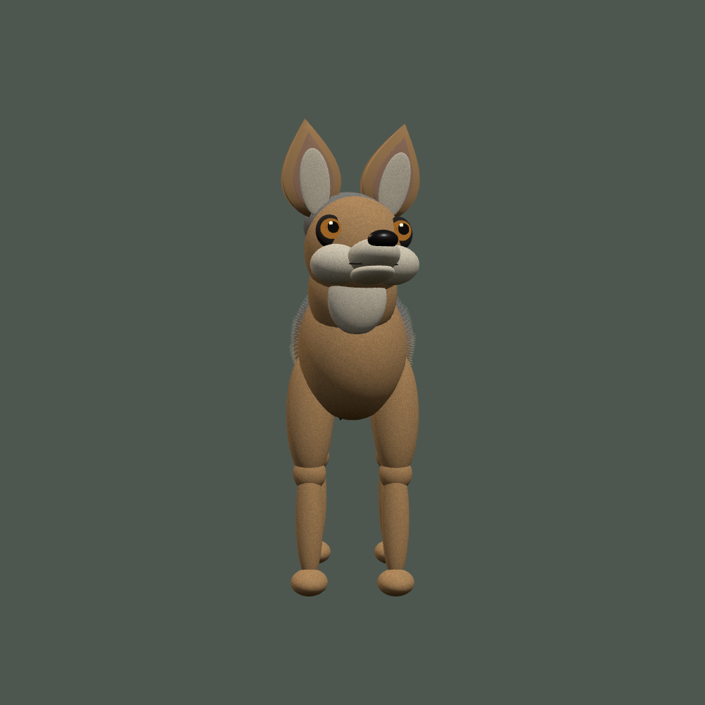
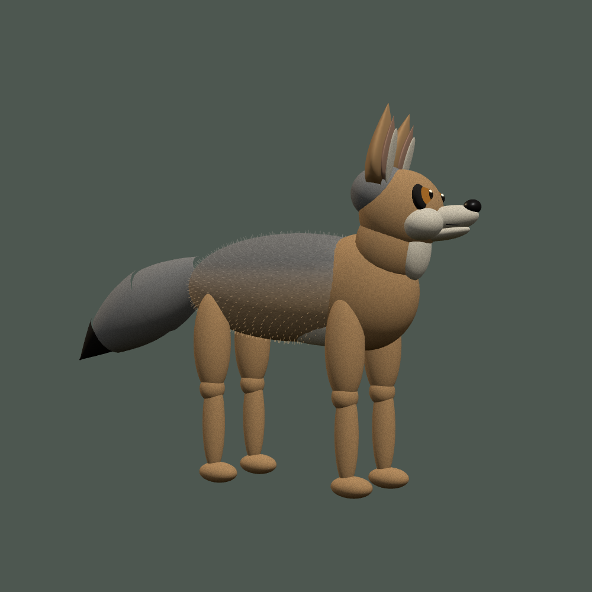
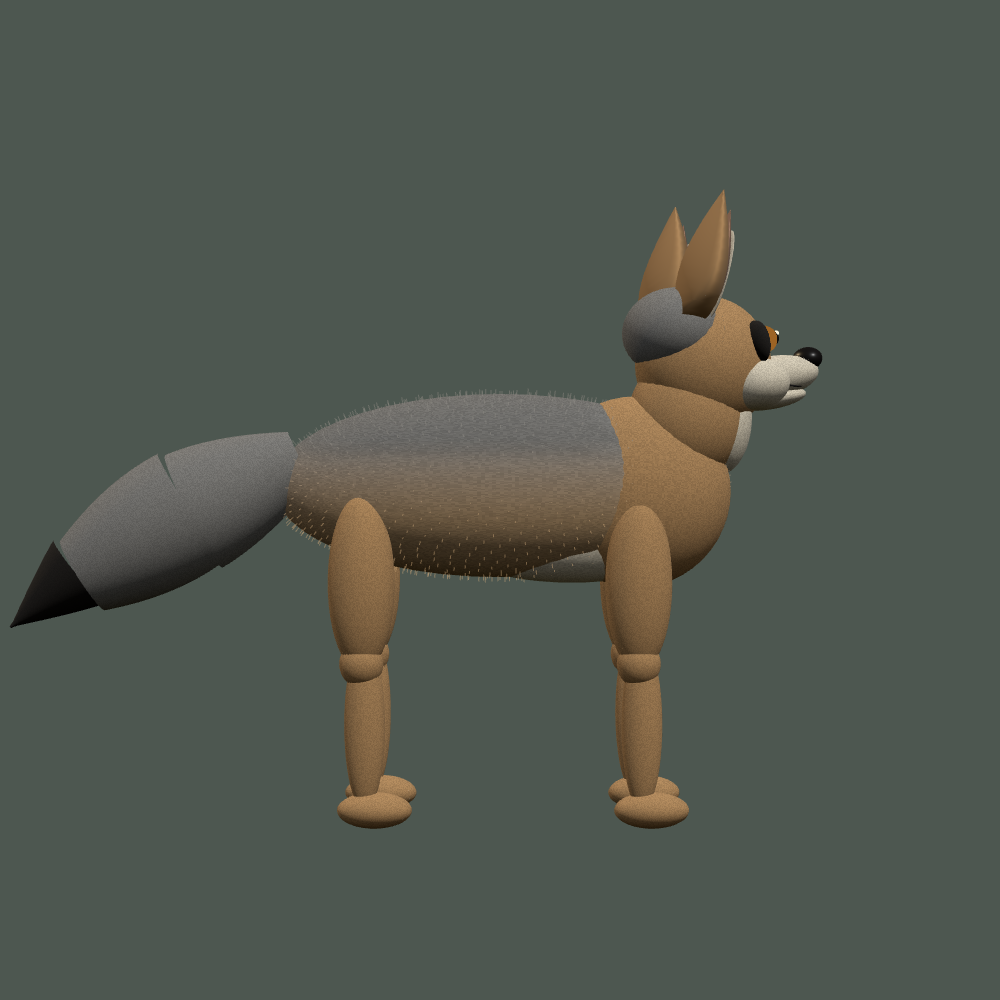

# Graxaim-do-campo

Modelo procedural próprio inspirado na referência, em vez do quadrúpede genérico. Corpo cinza com áreas douradas, peito e focinho claros, olhos castanhos com pupila e reflexo, nariz escuro, orelhas grandes com parte interna clara e cauda cheia com ponta escura. A variante ruiva continua disponível com a mesma anatomia.

Superfícies suaves, microtextura de pelagem, fibras curtas no dorso, contorno curvo das orelhas e cauda contínua distribuída pelas três articulações. O acabamento é estilizado; não é uma reprodução fotográfica.

Mantém as quatro pernas articuladas, joelhos e patas, pescoço/cabeça, orelhas independentes, cauda em três partes e reflexo dos olhos à noite. A postura neutra do pescoço foi ajustada ao novo corpo. Continua andando, farejando, sentando, se coçando, observando, alertando e fugindo com a IA existente. O nome no álbum de fotos é Graxaim-do-campo.

Os recursos gráficos são próprios por animal e liberados quando ele sai da fauna. Outros modelos de animais continuam no construtor existente.

## Verificação

18 testes unitários passaram, incluindo ambas as variantes, articulações, posições/normais finitas, apoio das patas e isolamento dos materiais. No jogo completo, o graxaim real do gerenciador de fauna foi criado e exercitado nas cinco atividades, alerta e fuga, sem erros JavaScript. Também foram verificados movimento das pernas e remoção do animal. Build atualizado.

## Capturas do código do jogo

| Frente | Três quartos | Perfil |
|---|---|---|
|  |  |  |
