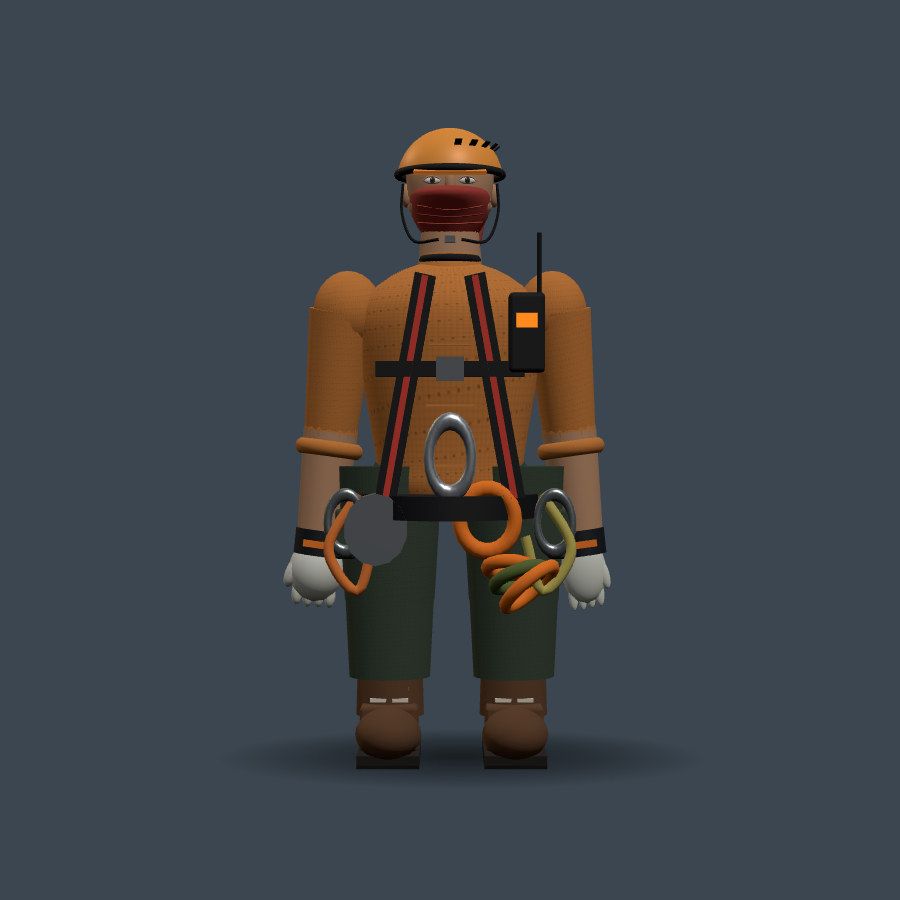
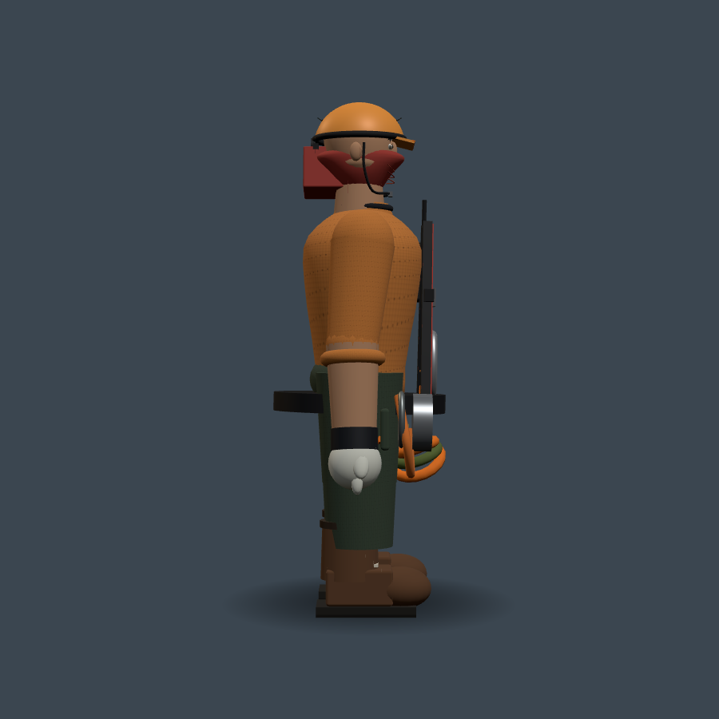
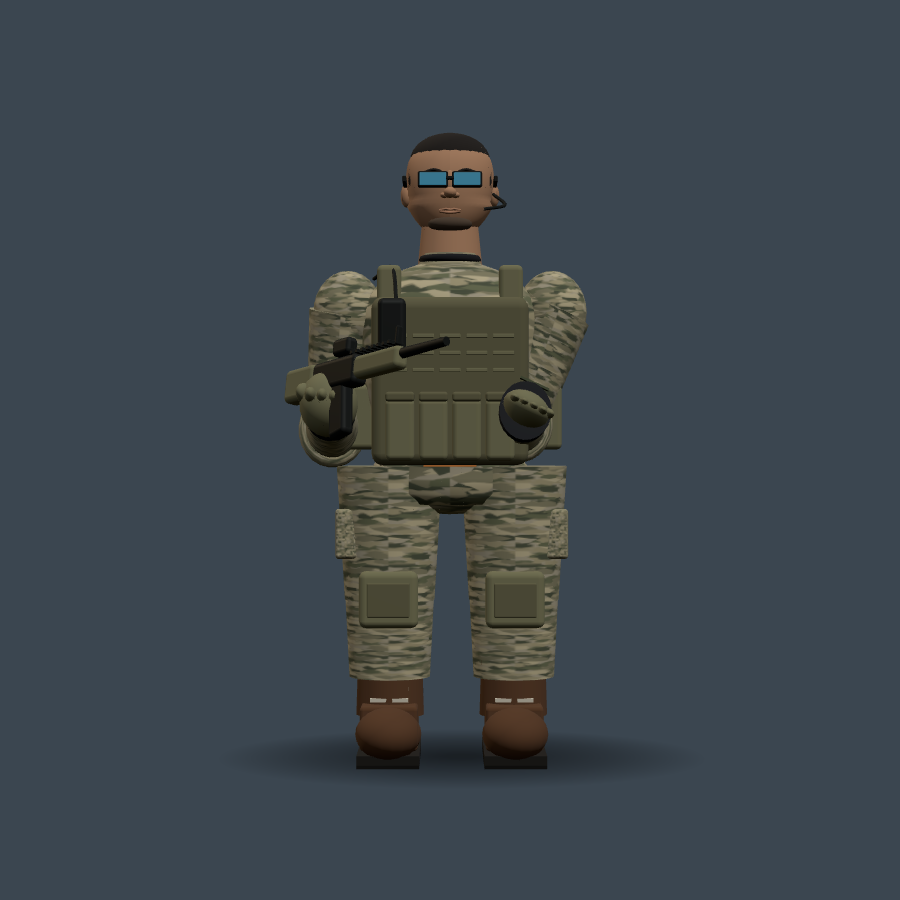
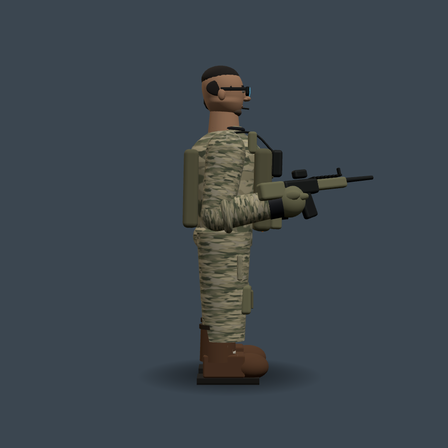
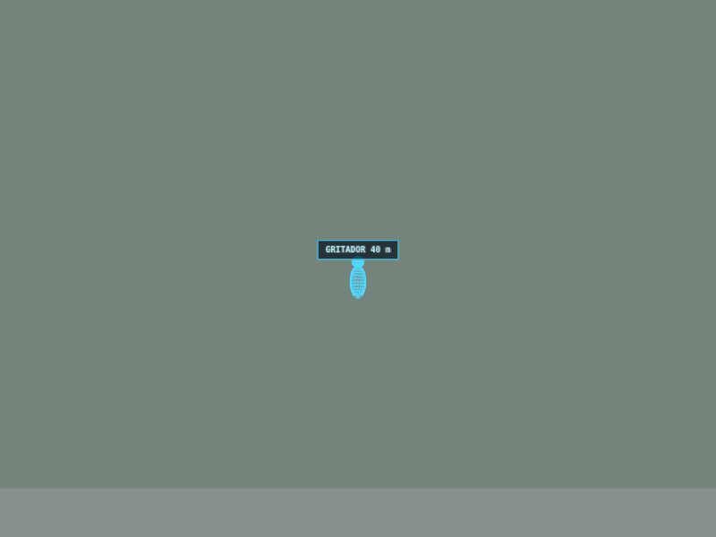

# Jackão — visual, login e poderes

Modelo exclusivo, adaptando o concept ao estilo 3D procedural do jogo. Normal: pele morena, uniforme laranja, calça verde, capacete de resgate, lenço vermelho sobre nariz/boca, luvas claras e cinto com cordas e mosquetões. Poder: rosto descoberto, cabelo curto, roupa camuflada de manchas orgânicas, colete tático com bolsos e rádio, joelheiras, coturnos, luvas e óculos azuis de RA. Sem bandeiras, brasões ou insígnias militares reais.

| Forma | Frente | Perfil |
| --- | --- | --- |
| Normal |  |  |
| Camuflado |  |  |

## Login

`data/seguranca/senhas.js`: preencher `OPERADORES.jackao.salt`, `iter` e `hash`; login reservado `jackao`. Gerar com `tools/gerar-hash.html` ou `node tools/gerar_hash.mjs jackao jackao`. Nunca colar senha em texto no repositório. PBKDF2/SHA-256, salt próprio, pelo menos 100.000 iterações. Enquanto o placeholder estiver vazio, a vaga fica indisponível em produção. A sessão é por aba.

No debug (localhost ou `?debug`), `teste.jackao` usa a senha de teste já configurada. O login genérico `teste` continua apontando para Pit. Login de teste não funciona em produção sem debug.

Com Jackão logado e selecionado, entrar na época 1950 transforma automaticamente; voltar a 2026 restaura roupa, acessórios e materiais originais e desliga mira/RA.

## Comandos e comportamento

| Ação | Teclado/mouse | Controle padrão |
| --- | --- | --- |
| Fuzil | Clique/segurar esquerdo ou V | R2/segurar |
| Mira | Segurar botão direito | L2 |
| Granada | Q | R1 |
| Óculos de RA | E | L1 |
| Alternar choque/comum | F | Triângulo |

Y/U/I continuam como alternativas. Shift+Q/E/F deixa os comandos comuns disponíveis. Menus, campos de texto, construção e cenas de missão bloqueiam os comandos de poder. Gamepad usa o mapeamento padrão do navegador; os comandos de alternância não repetem enquanto o botão fica pressionado.

- Fuzil: reserva ilimitada, pente de 30 com recarga automática de animação; modelo com carregador animado, recuo, clarão de cano, zoom da mira e disparo sintetizado por Web Audio. Estabilizar a mira por 0,75 s concede tiro preciso. Sem sangue. Balas comuns não ferem animais nem pessoas.
- Granadas: **três por passagem na zona**. Trocar de personagem, desfazer/refazer transformação ou reabrir o modo andar na mesma zona não repõe. Sair da zona repõe três. O projétil percorre um arco; fusível, explosão e fumaça usam o tempo de simulação e congelam com o poder do Pit. Explosão empurra/danifica ameaças registradas; não altera vegetação, terreno, animais ou pessoas.
- RA: contorno das geometrias reais dos alvos (ou marcador de posição quando não há modelo), rótulo e distância, até 150 m. Materiais sem teste/escrita de profundidade, sem névoa, com ordem de renderização de sobreposição. Mostra ameaças registradas, incluindo o Gritador, mesmo ocultas pela mata/neblina. Remove marcações ao desligar, morrer ou sair do alcance.
- Choque: atordoa o animal na mira sem alterar sua vida; em sombras/guardiões encadeia até três atordoamentos sem dano.

Limites, alcance, fusível, recarga e danos ficam em `data/poderes.js`, entrada `jackao`.

## Testes e prints

- `npm --prefix t3d run build`
- `npm --prefix t3d test`: inclui login real com hash temporário de teste, salt exclusivo e rejeição de `teste.jackao` fora do debug.
- `npm --prefix t3d run test:browser`: regressão dos 11 personagens e recargas.
- `npm --prefix t3d run test:jackao`: teste de pixels com inimigo atrás de obstáculo opaco e névoa densa; três granadas e quarta recusada, fusível congelado, troca de personagem/zona, civis intactos, mira, recarga, choque sem dano, mouse, gamepad simulado e reentrada no modo andar.
- Servir a raiz com `python -m http.server 8000`; executar `npm --prefix t3d run test:jackao:game` para o bundle real na área de treino debug. A sessão é simulada nesse teste; o PBKDF2 é validado separadamente. Verifica transformação automática, as três granadas, Q/E/F, RA, choque e retorno ao normal.
- `JACKAO_SCREENSHOTS=1` salva os quatro retratos no teste integrado e o print de RA no teste isolado. `PLAYWRIGHT_CHROMIUM_EXECUTABLE` permite apontar o Chromium instalado; `JACKAO_GAME_URL` troca a URL do servidor.

O teste renderizado conta pixels cianos: sem RA, zero; com RA, mais de mil pixels visíveis, mesmo com obstáculo e névoa. Controle físico não estava disponível; botões foram validados pela Gamepad API simulada. O build mantém os avisos preexistentes de chaves duplicadas em `cenario.js` e `terreno.js`.
