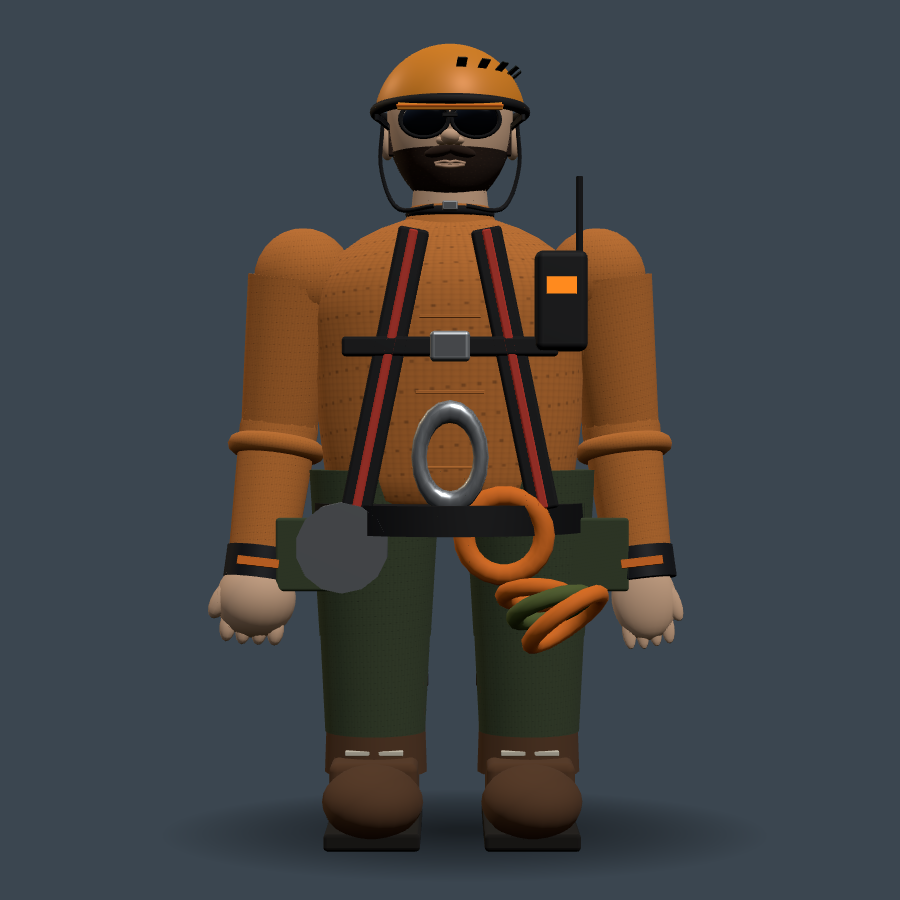
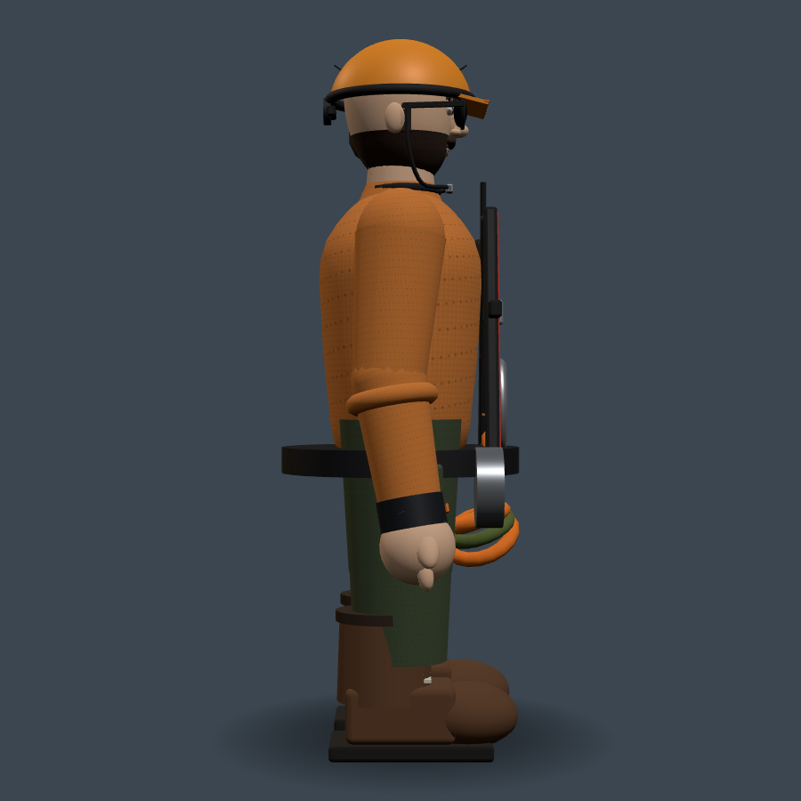
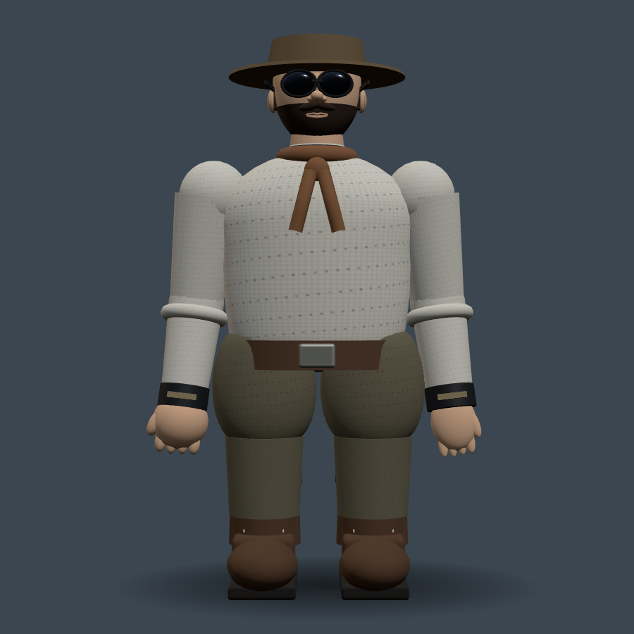
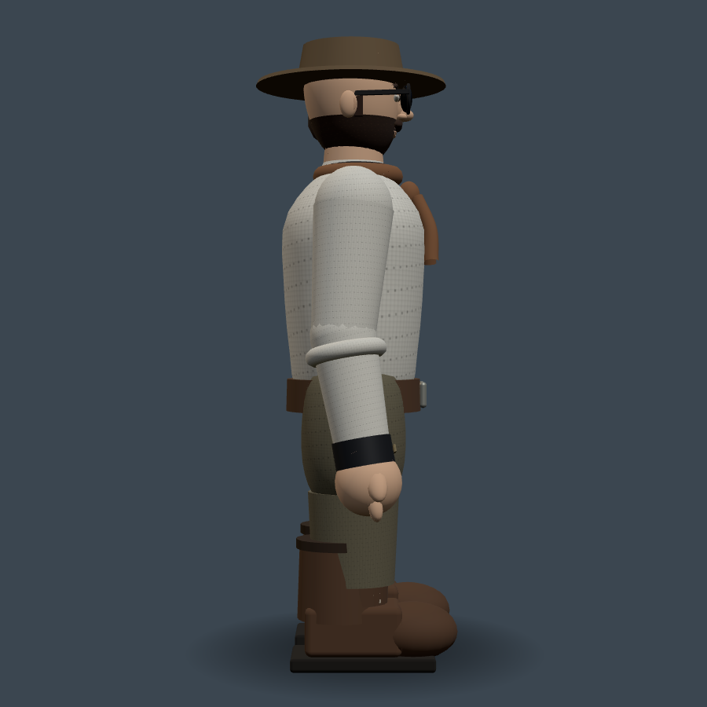
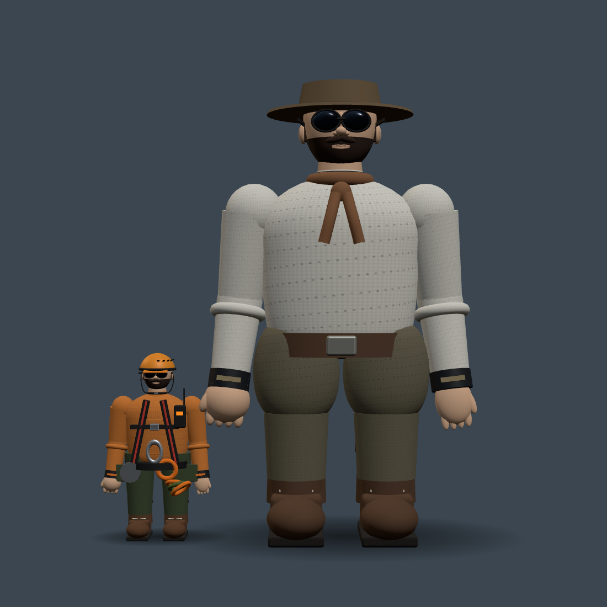

# Kauling — Peão gaúcho

Visual procedural com corpo largo, barba castanha, óculos escuros e uniforme laranja/verde da tirolesa. No tempo antigo, camisa clara, bombacha, lenço, guaiaca com fivela, botas de couro e chapéu gaúcho. O capacete e o equipamento de resgate ficam na forma normal. O acabamento é estilizado, sem reproduzir o realismo fotográfico da referência.

## Login

Placeholder `kauling` em `data/seguranca/senhas.js`: preencher salt exclusivo e hash PBKDF2-SHA256, 100000 iterações. Use o gerador local em `tools/gerar-hash.html`. Campos vazios bloqueiam produção. `teste.kauling` usa a credencial de teste existente somente em localhost ou modo debug. Nenhuma senha em texto claro foi acrescentada.

## Comandos

| Ação | Teclado/mouse | Controle |
|---|---|---|
| Crescer / encolher | E | L1 |
| Grito forte | Clique / V | R2 |
| Grito curto | F | Triângulo |

Crescimento configurável em `data/poderes.js`: 2,5× por 20 segundos. Grito gigante tem força/dano 1,7×, passos geram tremor leve e atordoam por perto. A câmera se afasta e sobe com o personagem, inclusive em primeira pessoa. O tamanho original é restaurado ao sair da forma ou trocar de personagem.

Copas próximas são verificadas pela altura/posição das árvores instanciadas e pelos polígonos de mata baixa. Uma copa baixa impede crescer; entrar sob uma copa baixa força o encolhimento. Árvores altas permitem a passagem, sem proibir toda a floresta.

O grito forte lança inimigos em uma trajetória com velocidade e gravidade, restaura a IA no pouso e produz anéis visíveis, som sintetizado e rajada de vento para a vegetação. Preserva civis e animais. O grito curto imobiliza animais e alvos próximos sem dano. As falas gaúchas aparecem no terminal do jogo.

## Verificação

- 15 testes unitários passaram, incluindo autenticação própria e isolamento do debug.
- Cinco cenários de navegador: crescimento/expiração/restauração; copas baixas e altas; arremesso e preservação de civis/animais; grito curto/pisadas; E/F, mouse e gamepad.
- Regressão dos poderes dos 11 personagens passou, sem erros JavaScript.
- Bundle completo: transformação bloqueada sem sessão, transformação automática com sessão no passado, crescimento 2,5×, câmera afastada, alvo lançado pelo ar, grito curto não letal, retorno ao uniforme e matrizes finitas.

O retrato gigante inclui o Kauling normal ao lado, na mesma cena, para comparar a escala de 2,5×. As capturas são renders do código do jogo.

## Prints

| Forma | Frente | Perfil |
|---|---|---|
| Normal |  |  |
| Peão |  |  |

