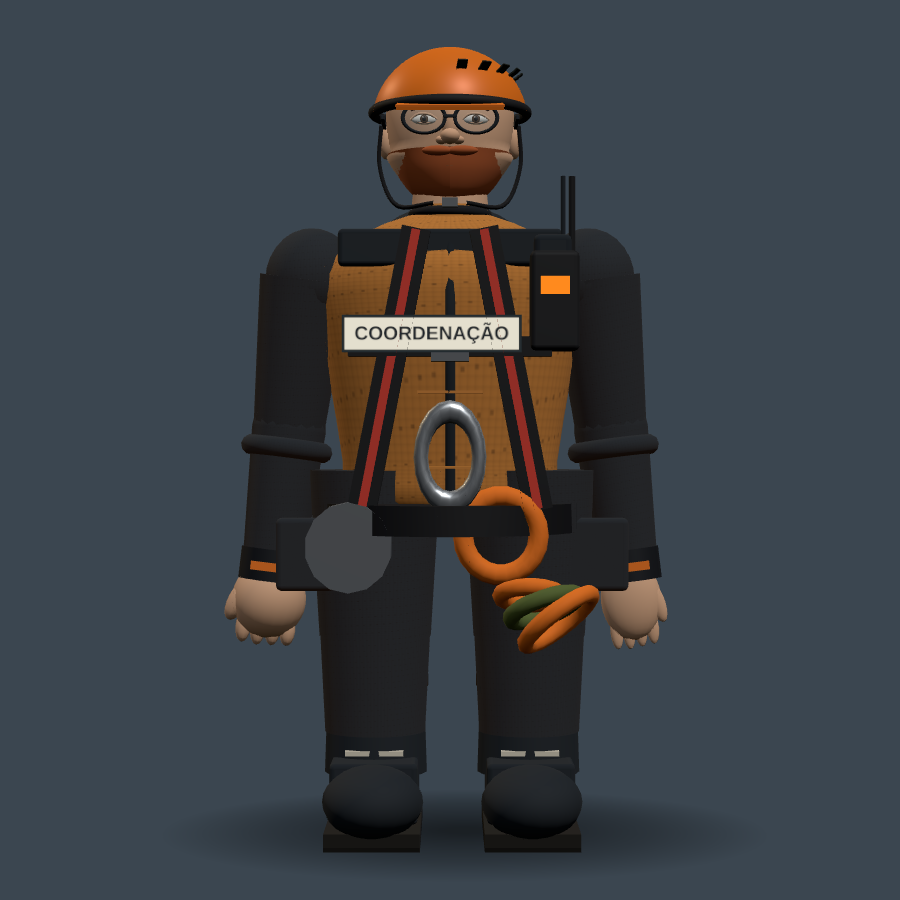
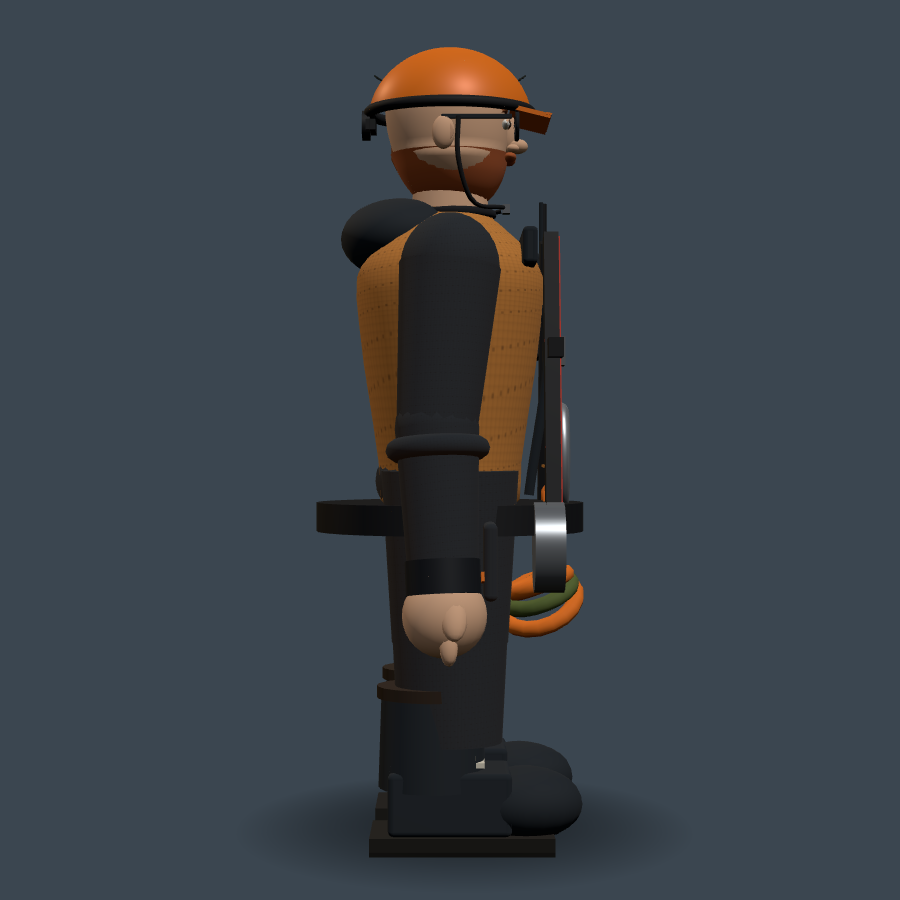
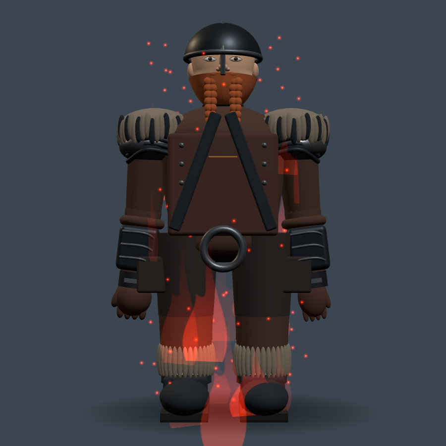
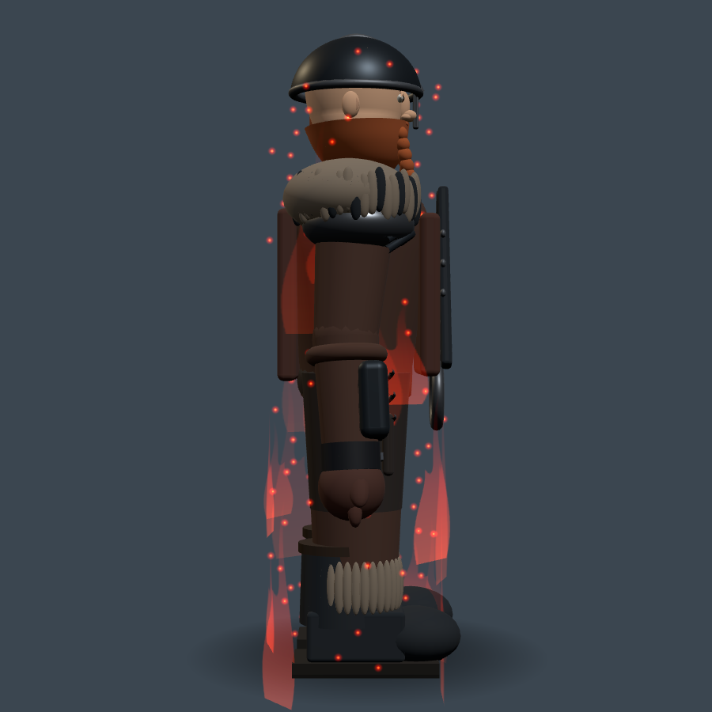
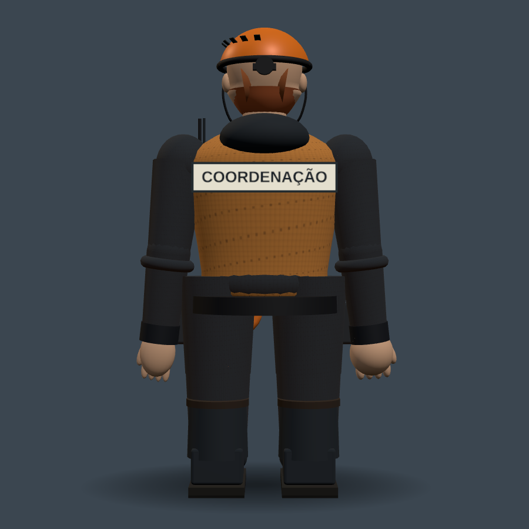

# Krig — coordenador e Viking sem chifres

A referência foi adaptada à modelagem 3D procedural do jogo. A instrução final prevalece: **a forma Viking não tem chifres**. O modelo é usado no personagem jogável, no coordenador das missões e no NPC do lançamento.

Normal: homem de porte forte, barba ruiva, óculos de grau claros, capacete laranja, jaqueta laranja/escura, calça e botas escuras, cinto de resgate e rádio. A identificação **COORDENAÇÃO** aparece no peito e nas costas. As duas placas usam textura frontal e escalas positivas; a placa traseira gira 180°, preservando a leitura.

Viking: elmo de ferro com nasal e rebites, sem chifres; barba ruiva maior com duas tranças e anéis; peles nos ombros e botas, couro, ombreiras metálicas e braceletes. A Fúria inclui chamas vermelhas em volta do corpo, faíscas, movimento da barba e tremor breve ao transformar.

| Forma | Frente | Perfil |
| --- | --- | --- |
| Coordenação |  |  |
| Viking sem chifres |  |  |

## Login e rádio

Em `data/seguranca/senhas.js`, preencher `OPERADORES.krig.salt`, `iter` e `hash`. Login reservado: `krig`. Gerar com `tools/gerar-hash.html` ou `node tools/gerar_hash.mjs krig krig`. PBKDF2/SHA-256, salt próprio e mínimo de 100.000 iterações; não inserir senha em texto. Enquanto o placeholder estiver vazio, a vaga fica indisponível em produção.

`teste.krig` usa a senha de teste existente exclusivamente em localhost ou `?debug`. O login genérico `teste` continua como Pit. Transformação automática ao entrar em 1950 com Krig logado e selecionado; sair do tempo antigo restaura a forma normal e encerra o voo.

Nas missões do parque atual, Krig transmite mensagens de coordenação no início, na conclusão e na interrupção da missão. Na operação de lançamento, ele faz a confirmação pelo rádio com o recebimento. A pose de rádio acompanha as falas do coordenador; as mensagens não avançam objetivos nem concedem autorizações automaticamente.

## Poderes

| Ação | Teclado/mouse | Controle padrão |
| --- | --- | --- |
| Investida | Clique curto no cenário ou V | R2 |
| Golpe no chão | Q | R1 |
| Ligar/desligar voo | E | L1 |
| Rugido | F | Triângulo |

Os atalhos antigos Y/U/I permanecem. Shift+Q/E/F deixa disponíveis os comandos comuns. Arrastar a câmera não dispara investida. O controle padrão detecta o início do pressionamento e não repete alternâncias com o botão segurado. Menus, campos de texto, construção e cinema bloqueiam os poderes.

- **Voo:** pés até 5 m acima do chão. O limite é aplicado mesmo se `vooM` for configurado acima de cinco. Velocidade padrão de voo = dobro da corrida, inclusive sem segurar Shift. A câmera acompanha a altura; pular durante o voo não soma altura. O voo ignora a lentidão e o bloqueio de água no solo, mas respeita obstáculos na altura do personagem e os limites do mundo.
- **Pouso:** descida até o chão, com pulso e empurrão leves, sem dano. A transformação ou troca de personagem cancela o voo e restaura a velocidade.
- **Investida:** avança até o último ponto livre, com rastro de impacto e colisão na altura do voo. Mantém a altura ao teleportar para o destino.
- **Golpe:** empurra e atinge ameaças próximas. Se iniciado no ar, o impacto só acontece ao chegar ao chão.
- **Rugido:** atordoa animais e sombras sem reduzir vida. Pessoas não recebem dano nem atordoamento dos ataques de controle; os empurrões ofensivos só atingem inimigos e guardiões registrados.

Parâmetros em `data/poderes.js`, entrada `krig`. A correção no modo andar aplica a altura visual e a câmera ao sistema de flutuação já existente.

## Validação

- `npm --prefix t3d run build`
- `npm --prefix t3d test`: PBKDF2 próprio, login de teste restrito ao debug e coordenação pelo rádio.
- `npm --prefix t3d run test:browser`: regressão dos 11 personagens, recargas e colisão da investida.
- `npm --prefix t3d run test:krig`: limite de voo mesmo com configuração de 12 m, multiplicador 2×, pouso sem dano, golpe adiado, rugido sem dano, Q/E/F, clique e controle simulado.
- Servir a raiz com `python -m http.server 8000`; `npm --prefix t3d run test:krig:game` usa o bundle real. O teste neutraliza fatores do solo e colisores numa área controlada, preservando o chão real para medir a altura dos pés. Mede deslocamento e velocidade estabilizados da corrida e do voo, limite de 5 m, salto bloqueado, câmera, pouso, retorno ao uniforme, ausência de chifres e identificação do NPC.
- `KRIG_SCREENSHOTS=1` salva os cinco prints no teste integrado. `KRIG_GAME_URL` permite outro servidor; `PLAYWRIGHT_CHROMIUM_EXECUTABLE` seleciona o Chromium instalado.

Medição do bundle real: corrida **17 u/s**, voo **34 u/s**, razão **2×**, altura máxima dos pés **4,9999996 m**. A câmera mirou a altura do personagem em voo, sem erros JavaScript.

O teste integrado simula a sessão após a validação separada do PBKDF2. O controle físico não estava disponível; os botões foram verificados pela Gamepad API simulada. O build mantém os dois avisos preexistentes de chaves duplicadas em `cenario.js` e `terreno.js`.
