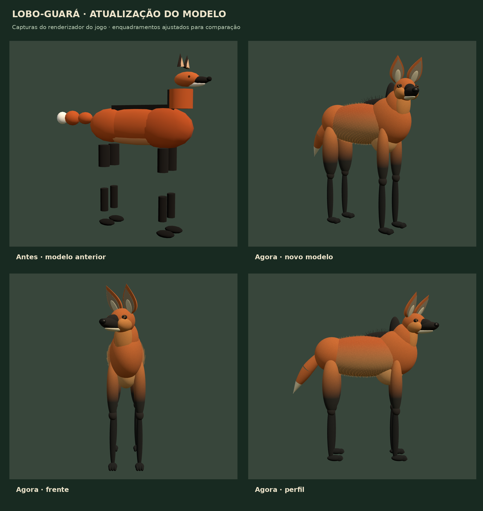

# Lobo-guará

O lobo-guará (`Chrysocyon brachyurus`) recebeu um modelo próprio, orientado pelas duas fotografias de referência: pernas compridas com extremidades escuras, corpo esguio alaranjado, crina preta, orelhas grandes, focinho estreito e cauda pendente com ponta clara. O modelo usa malhas curvas, textura procedural de pelo e fibras no dorso e na crina. Continua estilizado e procedural, com mais detalhes e proporções naturais; não é um modelo fotogramétrico.

As quatro pernas mantêm quadril, joelho e patas articulados. O pescoço e a cabeça receberam novas poses de repouso, alerta e farejamento; a classe Animal preserva caminhada, fuga e reflexo noturno dos olhos. O mesmo modelo é usado nas aparições do parque e do passado. Cada instância tem materiais próprios e descarte de geometrias, materiais e textura.

[Frente](media/lobo/lobo-frente.png) · [Três quartos](media/lobo/lobo-tres-quartos.png) · [Perfil](media/lobo/lobo-perfil.png)

Verificação: build do bundle, 29 testes automatizados, incluindo pés apoiados, proporções, geometrias finitas, marcha, farejamento, alerta, fuga, reflexo noturno e descarte dos recursos. O teste de navegador `t3d/test/browser/lobo.cjs` exercita o rig real por meio da classe Animal e gera as capturas, sem erros JavaScript. As capturas são de estúdio; o enquadramento é ajustado por modelo e não compara tamanhos absolutos.
