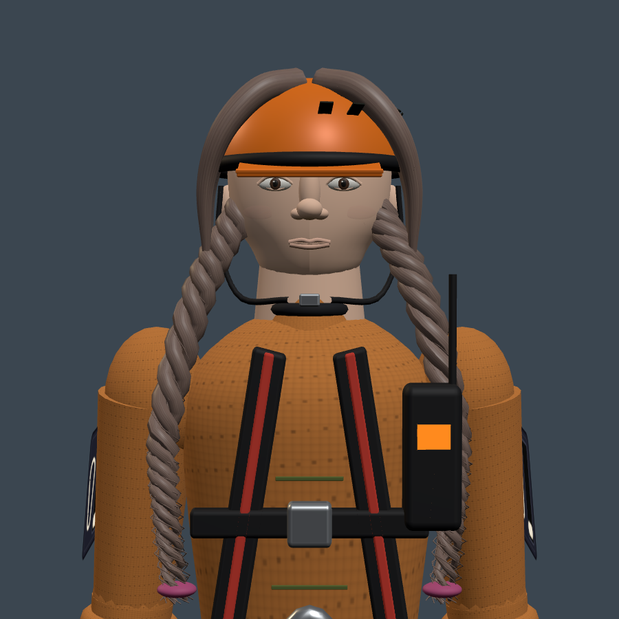
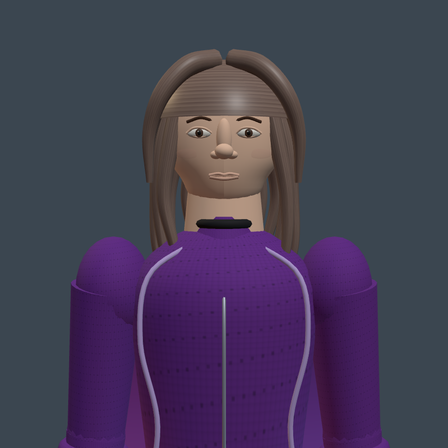
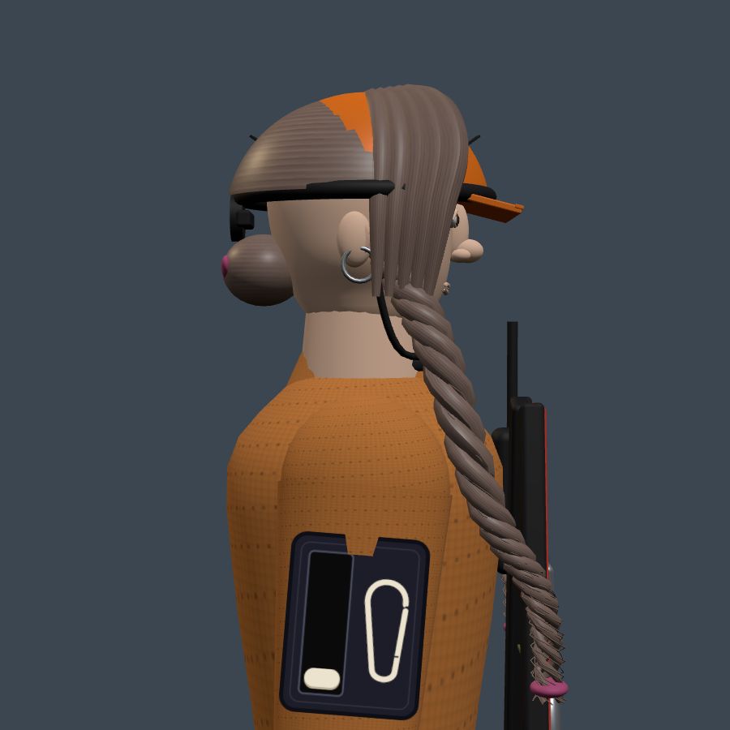
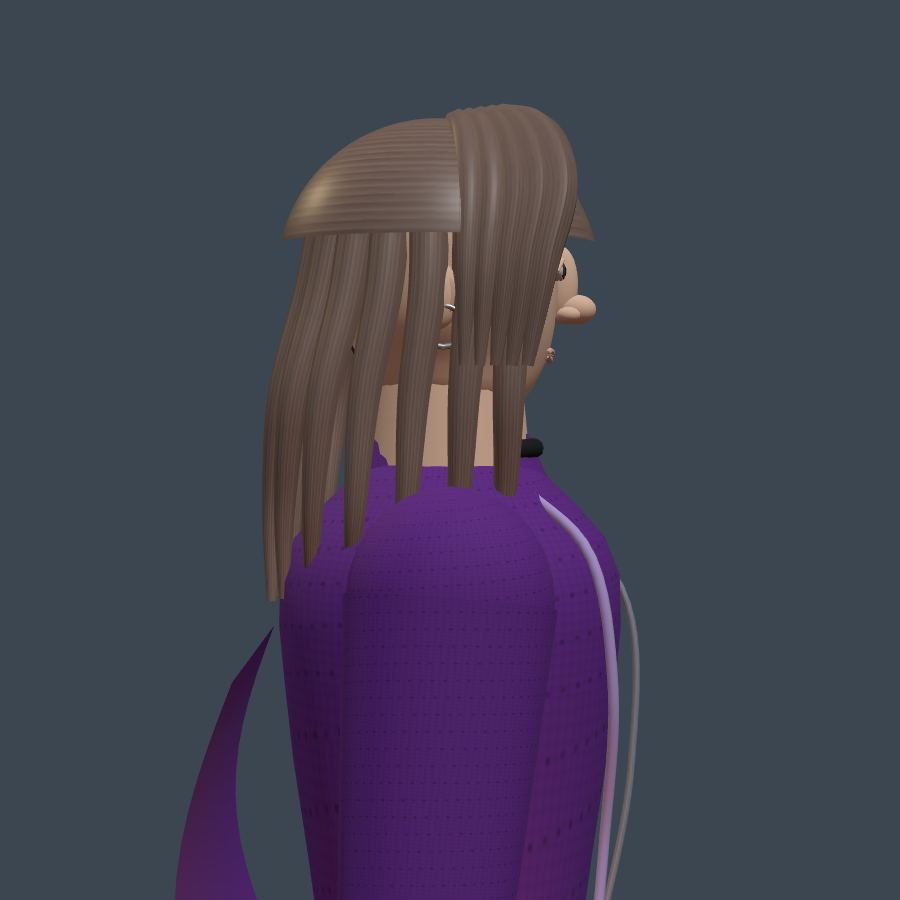
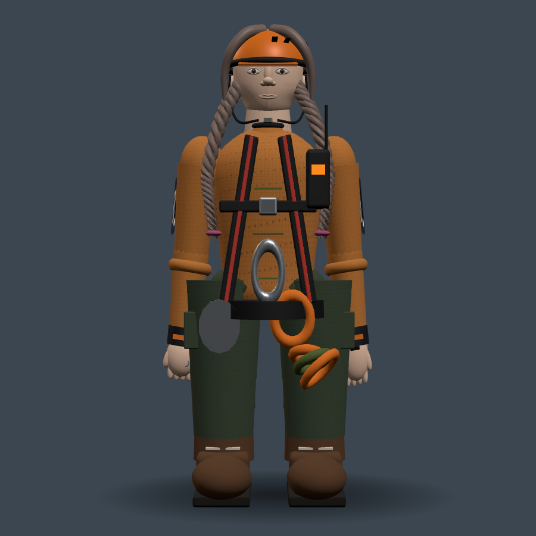
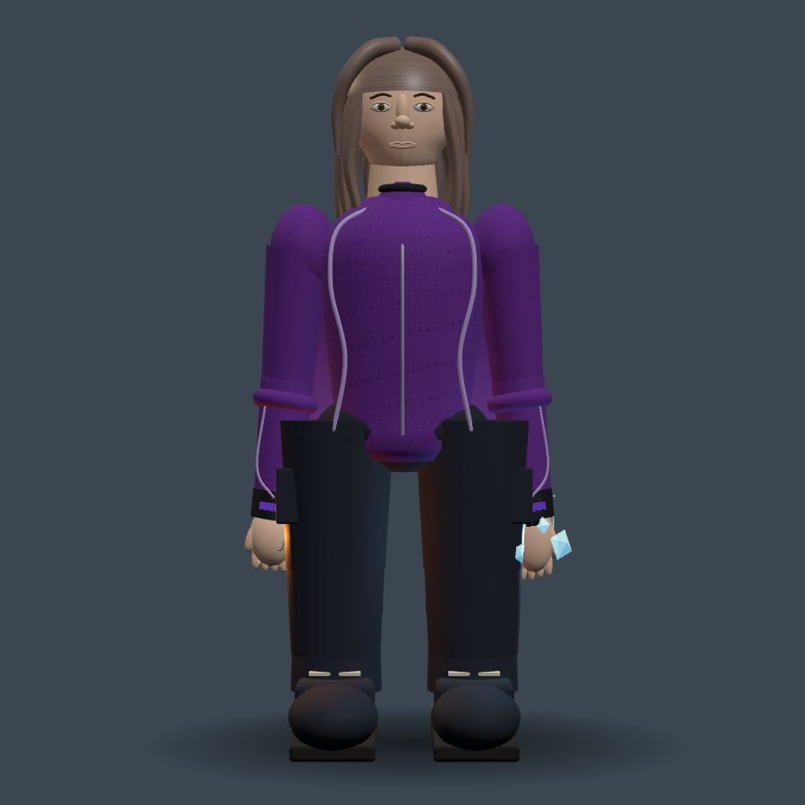

# Mary

Visual procedural integrado ao jogo: uniforme alinhado, maquiagem discreta, acessórios, duas tranças com três mechas entrelaçadas e fibras finas. Os eixos das tranças anteriores são preservados. No passado, jaqueta violeta, capa curta e detalhes lilás/prata, calça escura e cabelo solto.

Login `mary`: preencher `salt` e `hash` em `data/seguranca/senhas.js` com PBKDF2-SHA256 (100000 iterações). O placeholder bloqueia o login em produção. `teste.mary` usa a credencial de debug já configurada, somente localhost ou modo debug.

| Ação | Teclado/mouse | Controle |
|---|---|---|
| Fogo da mão direita | Clique / V | R2 |
| Gelo da mão esquerda | E | L1 |
| Vapor em alvo congelado | Q | R1 |

O fogo verifica todo o trajeto entre quadros, incluindo polígonos de mata e árvores isoladas. Apaga antes de atravessar a vegetação. Explosões não ferem civis ou animais. Gelo e cristais seguem o relógio da simulação, inclusive tempo parado. O fogo em alvo congelado também gera vapor automaticamente.

Validação: 13 testes unitários, sete cenários de navegador da Mary e jogo completo: bloqueio sem login, transformação automática, eixos das tranças, gelo/vapor, retorno ao uniforme e matrizes finitas. Build atualizado.

## Capturas do jogo

| Vista | Normal | Poder |
|---|---|---|
| Frente |  |  |
| Perfil |  |  |
| Corpo inteiro |  |  |
