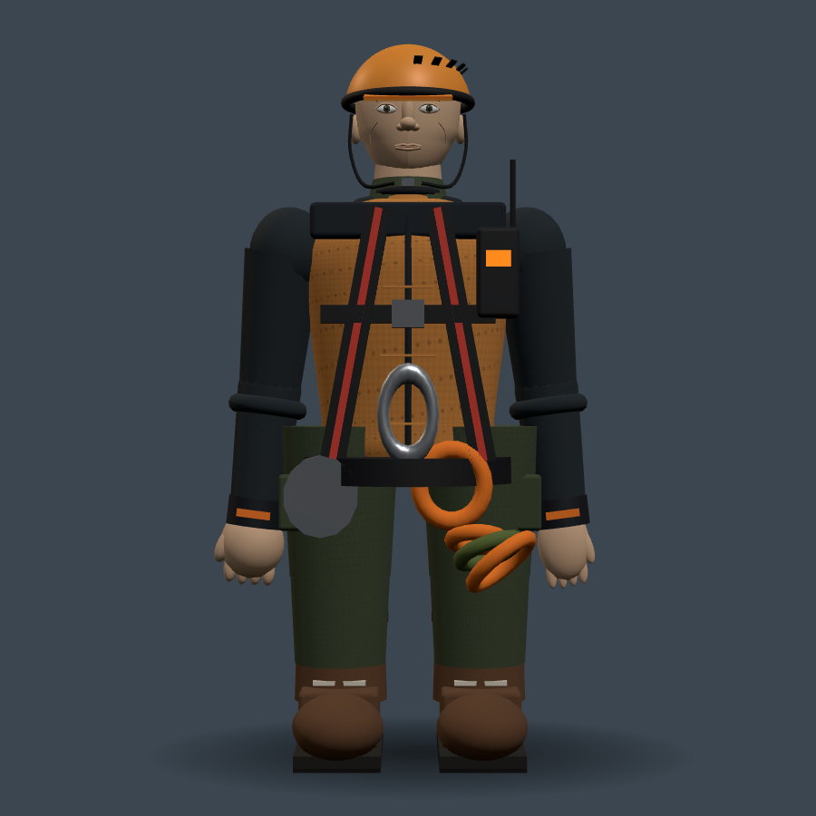
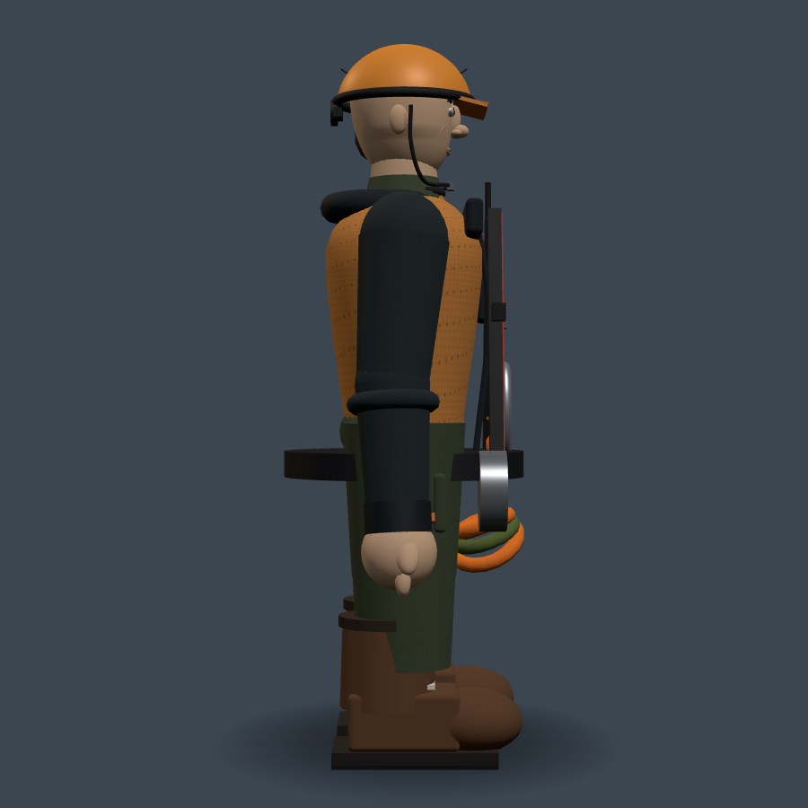
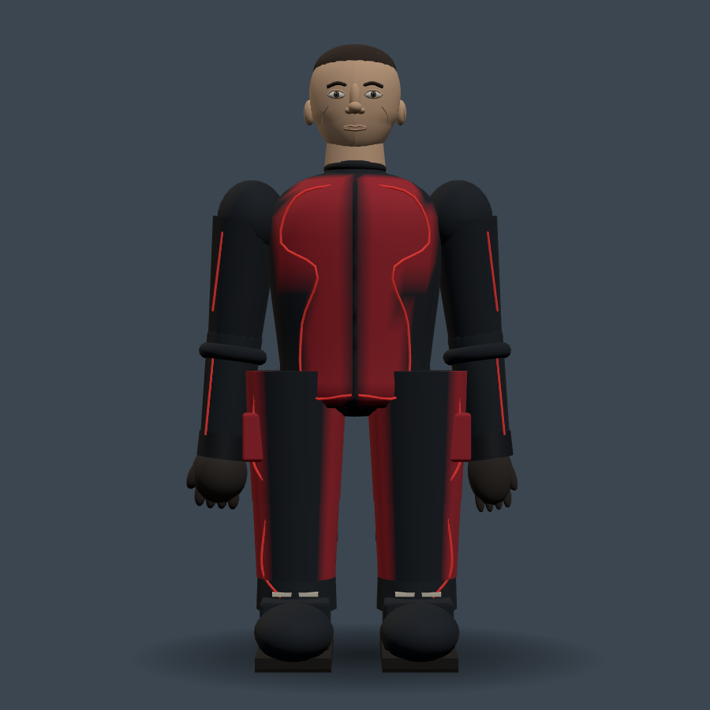
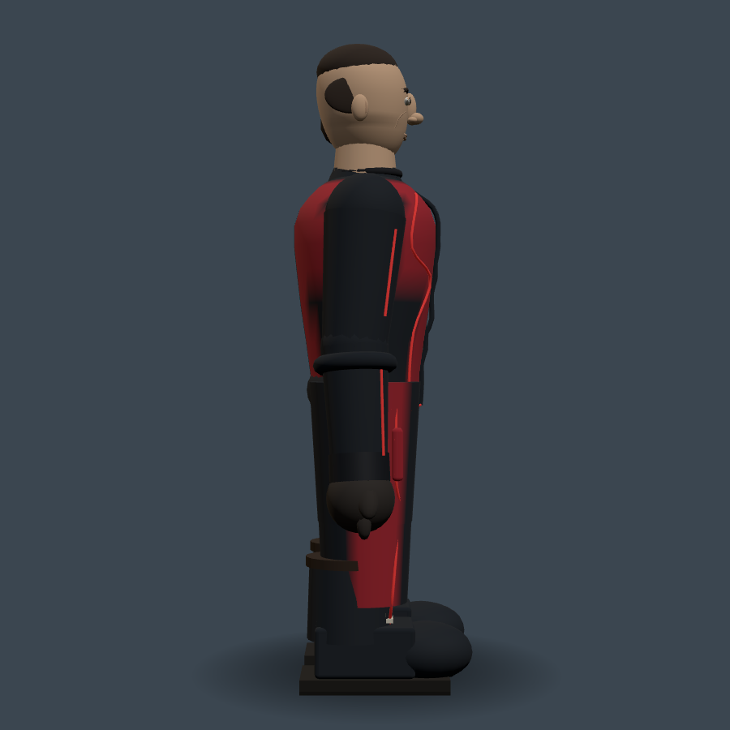

# Mohr — visual, login e poderes

Referência adaptada à modelagem 3D procedural do jogo. Mohr tem rosto próprio, cabelo castanho curto, expressão séria e sem barba. No presente, usa capacete laranja, jaqueta laranja/escura da equipe, calça verde, cinto, mosquetões, cordas e rádio. A forma Rubro remove o equipamento de resgate e o capacete, com jaqueta/calça em recortes vermelhos e pretos, luvas e botas escuras.

Os recortes são cores do tecido nas geometrias, acompanhando o contorno do corpo. Os filetes vermelhos têm brilho leve em repouso e pulsam ao usar qualquer poder, voltando gradualmente à intensidade normal.

| Forma | Frente | Perfil |
| --- | --- | --- |
| Normal |  |  |
| Rubro |  |  |

## Login e transformação

`data/seguranca/senhas.js` possui `OPERADORES.mohr` com login `mohr` e placeholder para `salt`, `iter` e `hash`. Gerar com `tools/gerar-hash.html` ou `node tools/gerar_hash.mjs mohr mohr`; não inserir senha em texto no repositório. O sistema existente usa PBKDF2/SHA-256, salt próprio e mínimo de 100.000 iterações. O placeholder vazio mantém a vaga indisponível em produção.

`teste.mohr` funciona com a senha de teste já configurada somente em localhost ou `?debug`. O login genérico `teste` continua como Pit. Com Mohr logado e selecionado, a transformação é automática na época 1950; voltar a 2026 restaura a roupa original.

## Comandos

| Ação | Teclado/mouse | Controle padrão |
| --- | --- | --- |
| Onda | Clique curto no cenário ou V | R2 |
| Avalanche | Q | R1 |
| Lama | F | Triângulo |

Y/I permanecem como alternativas. Shift+Q/F permite os comandos comuns. Arrastar a câmera não dispara a onda. Menus, campos de texto, construção e cinema bloqueiam os poderes. Toque mantém o botão de poder e os atalhos da interface; gamepad usa mapeamento padrão, sem repetir alternâncias com o botão segurado.

## Comportamento

- **Onda:** procura água a até 25 m, usando o leito real, os segmentos dos rios/arroios, as poças e amostras ao redor do jogador. Isso detecta cursos estreitos que a busca anterior podia perder. Com água real, a força e o alcance aumentam em 60%; o dano também recebe esse fator. Um arco de água liga a fonte ao jogador, seguido de crista translúcida, espuma e respingos. Sem fonte próxima, usa a umidade do solo com força básica. Empurra, derruba brevemente e encharca inimigos; não move nem fere pessoas.
- **Avalanche:** mede o gradiente do relevo à frente. Exige declive mínimo de 12%; no plano, avisa e não gasta recarga. Dezesseis pedras surgem encosta acima, aceleram no sentido da descida, rolam, sofrem gravidade e pequenos saltos ao tocar o solo. Poeira e ruído grave filtrado acompanham o deslizamento. Os impactos atingem ameaças registradas e recebem bônus contra alvos encharcados. Não modifica o terreno nem a vegetação.
- **Lama:** marca o chão aos pés dos alvos, prende inimigos e imobiliza animais sem reduzir vida. O efeito dura mais nos inimigos encharcados. Pessoas são preservadas. As marcas desaparecem ao terminar.

Simulação de água, pedras, poeira e lama congela com o tempo parado do Pit. Efeitos já lançados continuam até expirar ao trocar de personagem; sair do modo andar limpa os objetos e o áudio. Os parâmetros ficam em `data/poderes.js`, entrada `mohr`.

## Testes

- `npm --prefix t3d run build`
- `npm --prefix t3d test`: inclui PBKDF2 próprio e rejeição do login de teste fora do debug.
- `npm --prefix t3d run test:browser`: regressão dos 11 personagens e bônus contra alvos molhados.
- `npm --prefix t3d run test:mohr`: compara onda básica/forte, detecta um rio estreito, preserva civis, rejeita avalanche no plano, verifica descida e colisão das pedras, congelamento, limpeza de efeitos, lama sem dano, Q/F, clique/arrasto e Gamepad API simulada.
- Servir a raiz com `python -m http.server 8000`; `npm --prefix t3d run test:mohr:game` testa o bundle real. Procura um rio e uma encosta no mapa, sem substituir relevo ou água por versões simuladas, verifica onda, pedras, lama, brilho e retorno ao uniforme. A sessão é simulada nesse teste; PBKDF2 é validado separadamente.
- `MOHR_SCREENSHOTS=1` salva os quatro retratos. `MOHR_GAME_URL` escolhe outro servidor; `PLAYWRIGHT_CHROMIUM_EXECUTABLE` aponta o Chromium instalado.

Medição no mapa real: fonte **rio**, força **1,6×**, encosta com **17,58%** de declive e **16 pedras**, sem erros JavaScript. Controle físico não estava disponível; os botões foram testados com Gamepad API simulada. O build mantém os dois avisos preexistentes de chaves duplicadas em `cenario.js` e `terreno.js`.
