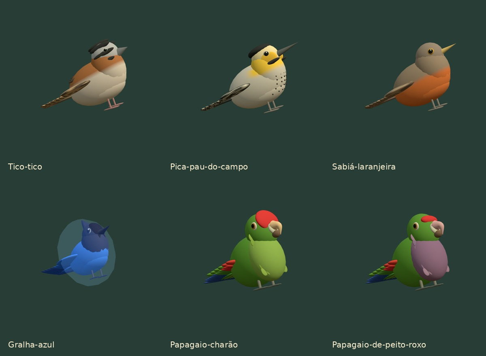
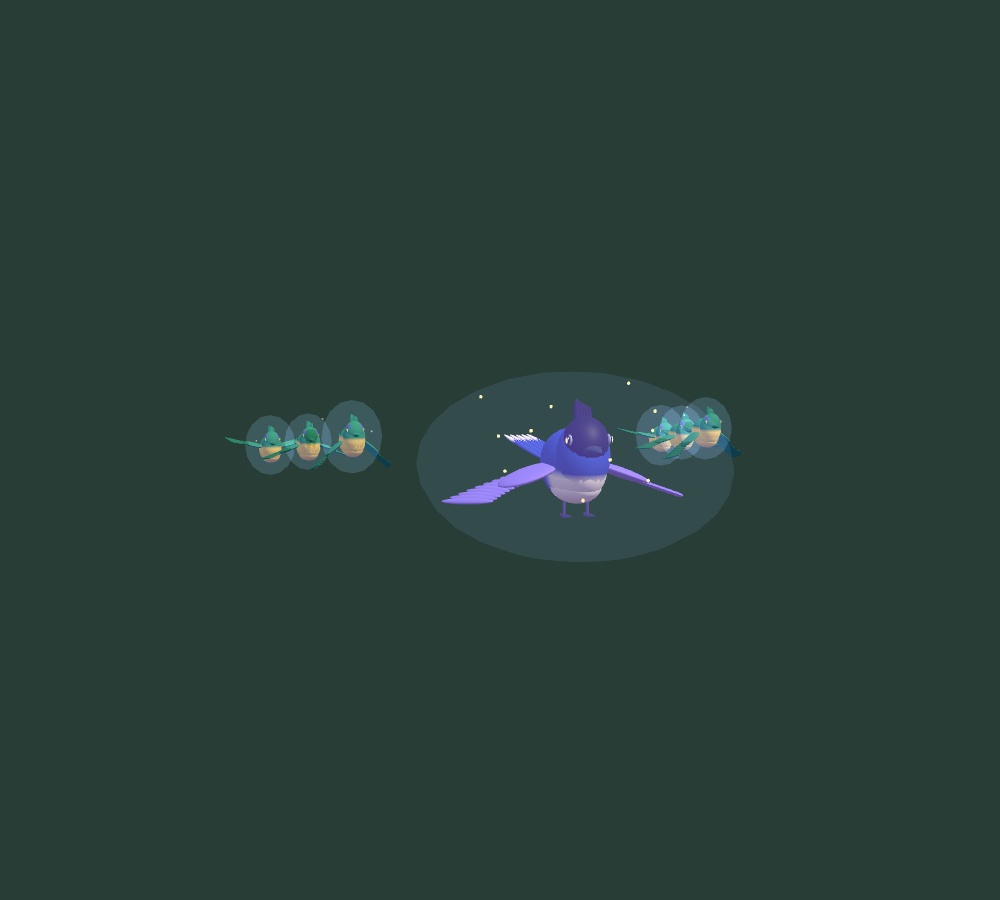
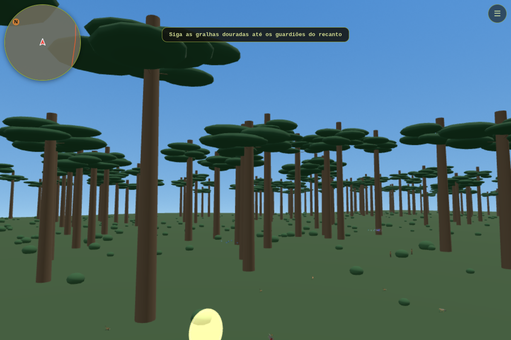

# Aves e jornada dos pinheirais

Modelos procedurais em 3D, com formas e cores baseadas nas referências fornecidas. As capturas mostram o estilo atual do jogo.

## Espécies

- **Tico-tico — Zonotrichia capensis:** substitui a identificação genérica “Passarinho”, incluindo geração, inspeção e fotografia. Cabeça cinzenta com faixas escuras, colar ferrugem, garganta clara, dorso e asas marrons rajados, bico curto e pernas rosadas. Mantém os saltos e bandos pequenos no chão. O canto permanece uma síntese de notas, sem gravação da espécie.
- **Pica-pau-do-campo — Colaptes campestris:** cabeça preta, face e garganta amarelas, corpo claro salpicado de escuro, asas barradas e bico comprido. Agora também busca alimento no chão dos campos e pode aparecer em pares.
- **Sabiá-laranjeira — Turdus rufiventris:** ventre alaranjado, dorso castanho, garganta clara riscada, bico amarelado e anel dourado nos olhos.
- **Gralha-azul:** cabeça e garganta pretas, corpo azul, bico reto, penas individuais nas asas e cauda e brilho sagrado. Bandos completos de 6 em 2026, 12 em 1950 e 20 a 40 em 1689–1700, com voo e pouso.
- **Papagaio-charão — Amazona pretrei:** verde, máscara vermelha, bico curvo claro, vermelho nas asas e penas azuis.
- **Papagaio-de-peito-roxo — Amazona vinacea:** verde com peito vinho-violeta e pequena testa vermelha. Possui geometria própria e não recebe a aura das gralhas.

## Corte sagrada

A **Gralha Ancestral Sagrada** é uma personagem mitológica da ficção do jogo, com plumagem azul-violeta, ventre claro, olhos dourados, cauda longa e partículas luminosas. Sua guarda tem exatamente **seis gralhas, em três casais**, com verde, amarelo, cabeça preta e detalhes violetas. Os bicos retos distinguem essas aves dos papagaios. A formação acompanha a rainha e se fecha para protegê-la quando atingida pelos poderes; a entidade espiritual não recebe dano.

Em 2026 há uma aparição concluída na Pedra do Segredo: passagem suave, reação do personagem e desaparecimento da corte pela luz, que se apaga. Em 1950 há três encontros ordenados na floresta da Olaria. As aparições concluídas são salvas no navegador e não se repetem. Uma cena interrompida pode ser retomada. No cenário ancestral, a corte permanece como guardiã do recanto.

## Progressão jogável

1. Após `m07-operar-lancamento`, completar **O chamado das gralhas** (`c01-gralhas`) e **A memória dos pinheirais** (`c02-urna`) no centro libera o portal violeta para 1950.
2. **As memórias das vilas** (`v01-memorias`) percorre Santana e Ouro Verde.
3. **As sementes da Olaria** (`v03-olaria`) conduz às três visões e libera o portal dourado.
4. Ao entrar no período **1689–1700**, Atiara é desbloqueada e selecionada. **Atiara e o recanto sagrado** (`v04-atiara`) conduz ao recanto com ajuda das gralhas.
5. O portal de retorno restaura 1950 e o personagem anterior. Sair do modo de caminhada preserva a localização ancestral salva.

As etapas de chegada verificam a época atual, permitindo iniciar a missão mesmo depois de atravessar o portal. Esses cinco capítulos constituem o novo arco; outras missões antigas ainda marcadas “em breve” continuam futuras.

## Floresta ancestral

Cenário autoral separado, de aproximadamente **1.600 × 1.200 metros**, inspirado nas bordas do Itaimbezinho. Araucárias de **42–61 metros**, com circunferências de **10,5–12,5 metros**, representam os troncos que exigem sete ou oito pessoas para abraçar. Há 340 árvores na qualidade baixa e 620 nas demais, colisores nos troncos, cânion, guardiões Kaingang e um recanto de animais. A cronologia e os diálogos pertencem à narrativa do jogo.

A população de fauna ancestral chega a 27 animais na qualidade baixa e 43 nas demais. A exibição simultânea usa limites de 14/24 animais por desempenho, além dos bandos de aves. Troncos, copas e aves usam instâncias para reduzir chamadas de desenho.

**Posicionamento:** o cânion é uma representação procedural, sem reprodução topográfica em escala 1:1. A Pedra do Segredo ainda não está identificada no KML existente; usa um marco provisório próximo à trilha, substituído automaticamente se um ponto com esse nome for adicionado ao mapa.

## Verificação

- `npm --prefix t3d test`: testes de unidade, incluindo bandos, geometrias, tico-tico, casais, aparições, progressão e floresta.
- `npm --prefix t3d run build`: gera o bundle distribuído.
- `node t3d/test/browser/poderes.cjs`: regressão dos 11 personagens e controles.
- `node t3d/test/browser/aves-sagradas.cjs`: capturas dos modelos reais, bandos e corte.
- Com o repositório servido em `http://127.0.0.1:8057/`, `node t3d/test/browser/pinheirais-game.cjs`: testa bloqueios de portais, persistência da visão de 2026, três visões em 1950, bandos, Atiara, fauna e retorno. Os marcos de missões são preparados pelo teste; ele não substitui uma campanha manual completa.

Os testes de navegador aceitam `PLAYWRIGHT_CHROMIUM_EXECUTABLE`. O teste do mundo aceita `GAME_URL`.
