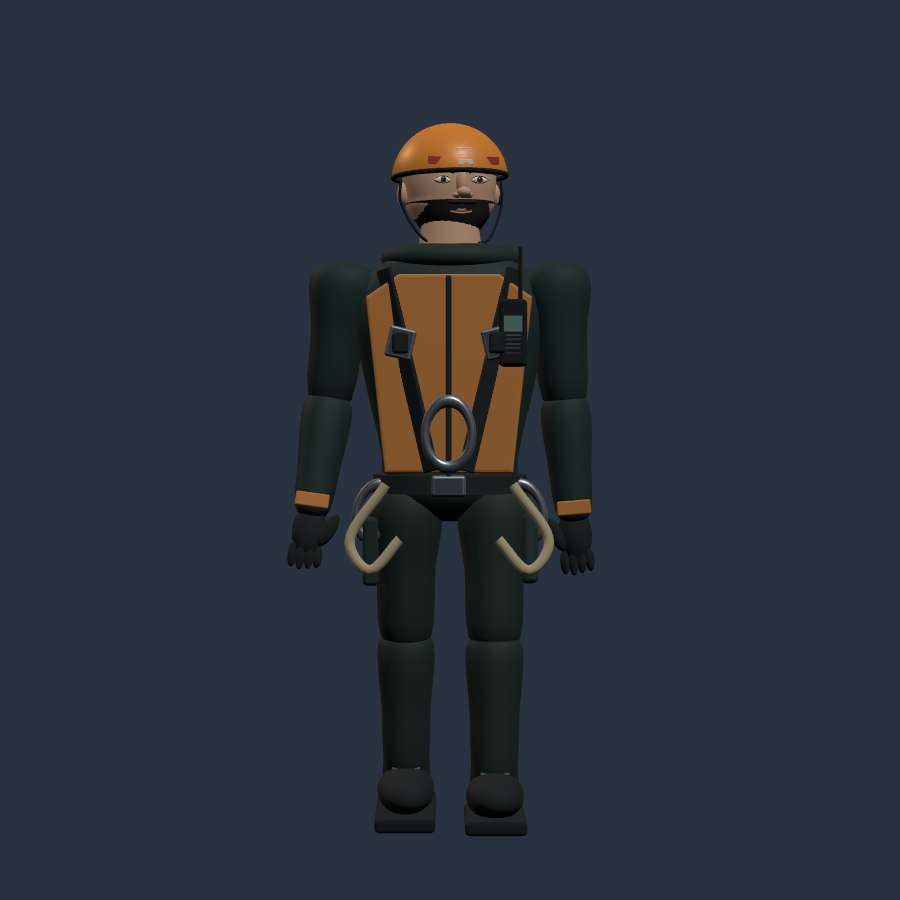
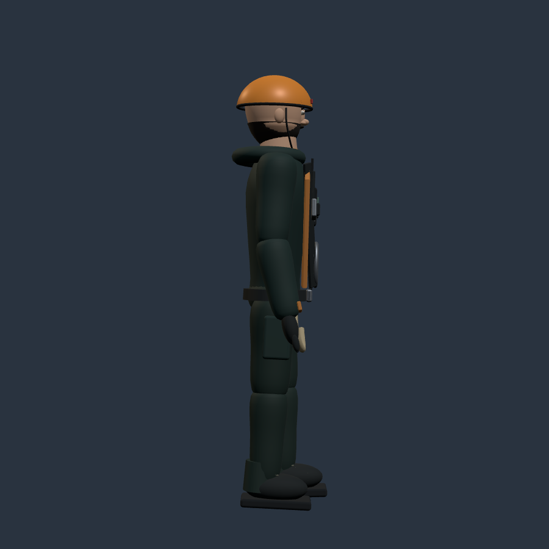
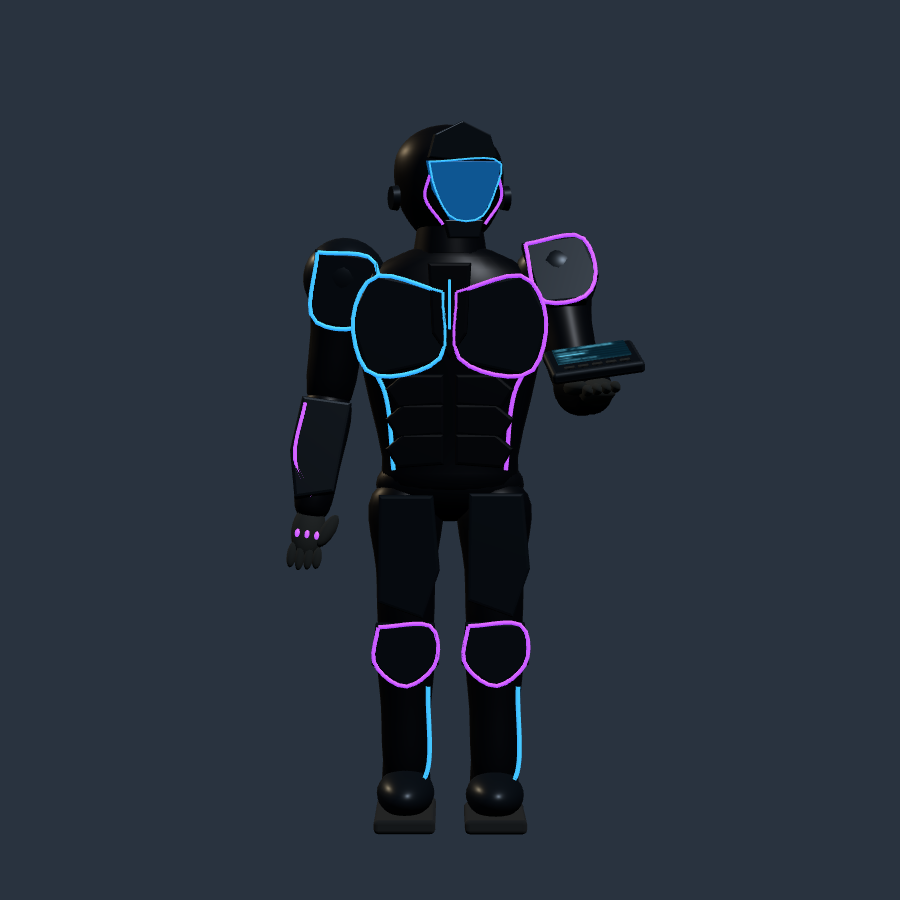
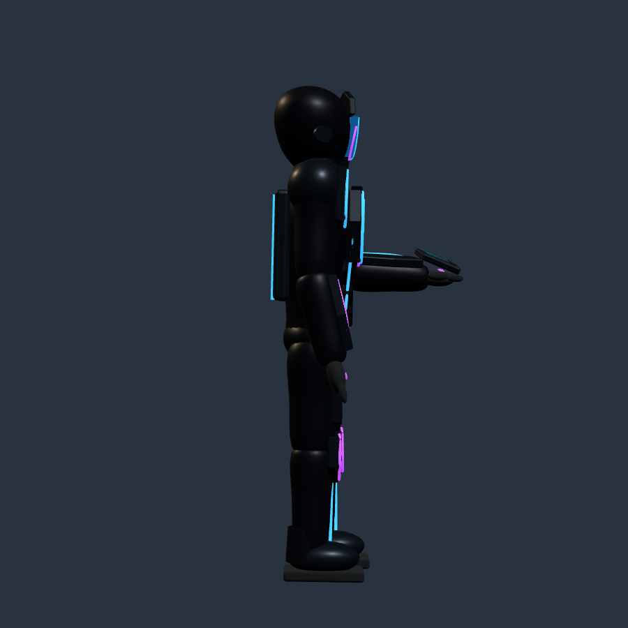

# Pit — visual, login e poderes

Pit tem modelo próprio no jogador e nas missões do Dia 1: pele morena clara, cabelo curto escuro, barba, uniforme verde-escuro/laranja, capacete de resgate, luvas, rádio, cinto, cordas e mosquetões. A referência foi adaptada à modelagem procedural do jogo; os prints abaixo são renderizações do código, não o concept fotográfico.

| Forma | Frente | Perfil |
| --- | --- | --- |
| Normal |  |  |
| Armadura |  |  |

## Login

Em `data/seguranca/senhas.js`, preencher `OPERADORES.pit.salt`, `iter` e `hash` com a saída de `tools/gerar-hash.html` ou `node tools/gerar_hash.mjs pit pit`. Login reservado: `pit`. Não inserir senha em texto. O placeholder vazio mantém a vaga bloqueada em produção. O Pit inicial pode agora ativar a armadura manualmente com T ou pelo painel “Pit / Desempenho”, sem login e sem atravessar o portal. A seleção das contas de operador mantém o login existente. A mudança solicitada libera o poder do personagem inicial; não altera senhas nem sessões dos outros operadores.

PBKDF2/SHA-256, salt próprio e mínimo de 100.000 iterações seguem o sistema existente. O login de teste `teste` agora seleciona Pit; `teste.pit` também funciona, com a senha de teste já configurada, exclusivamente em localhost ou `?debug`. Sessão por aba. Não há senha nova de produção neste commit.

## Poderes e comandos

A transformação manual com T funciona no presente e permanece ativa ao mudar de época. T novamente retorna ao uniforme. A troca de personagem e a saída da partida desfazem a forma, o voo e os poderes. A transformação automática de operadores logados em 1950 continua disponível. A armadura tem capacete integral, placas pretas, linhas azuis/violeta pulsantes e CardPuter com tela de energia e tipo. Pit não possui Lábia; ela continua na Diully.

| Ação | Teclado/mouse | Controle padrão |
| --- | --- | --- |
| Transformar / voltar ao normal | T ou painel Pit / Desempenho | Painel na tela |
| Voar / pousar | G ou painel | Painel na tela |
| Subir / descer no voo | Espaço / Ctrl | — |
| Acelerar no voo | Shift ou corrida ligada por R | — |
| Projetar holograma | Clique curto no cenário ou V | R2 |
| Alternar fraco/forte | Q | R1 |
| Hackear o alvo na mira | E | L1 |
| Parar tempo | F | Triângulo |

Os atalhos antigos Y/U/I continuam como alternativa. Shift+Q/E/F preserva os comandos comuns; E sem alvo hackeável segue para a interação normal. Arrastar a câmera não projeta holograma. Touch conserva o botão de poder e os atalhos da interface. Gamepad usa o mapeamento padrão do navegador e detecta o início do toque, evitando repetir enquanto o botão fica pressionado.

Fracos alternam entre animal e pessoa azuis; fortes são assombrações violeta. Todos têm varredura, tremulação, deslocamento e ataque automático contra ameaças próximas. Mirar um inimigo e projetar também define foco de ataque. Em `data/poderes.js`, `pit.maxHolos`, `holoSeg`, `holoCusto`, `holoConsumoSeg`, `holoRecarga` e `holoDano` controlam limite, duração, energia e dano. A energia é consumida enquanto há projeções e recarrega quando elas acabam.

Hack seleciona um sistema dentro do cone/alcance da mira. Portões de Santana abrem, luzes e máquinas industriais param temporariamente, e os valores das luzes são restaurados mesmo após trocar de personagem. Missões podem cadastrar outros sistemas com `M.poderes.pit.registraHackeavel(id, {pos, g?, hackear?, pausar?, religar?})`; `pos` pode ser `{x,z}` ou função. O retorno remove o cadastro. O poder emite `poder:hack` com o id do alvo para o sistema de missões.

Tempo parado suspende a simulação do mundo, incluindo NPCs, fauna/aves, água, partículas, flechas e hologramas. Pit e o relógio de duração do poder continuam; há dessaturação/glitch, com restauração do filtro anterior ao terminar. Duração e recarga são configuráveis.

## Validação

- `npm --prefix t3d run build`
- `npm --prefix t3d test` — inclui placeholder, PBKDF2, salt e rejeição do login de teste em produção.
- `npm --prefix t3d run test:browser` — 11 personagens, recargas e cenários extras de Pit: mira/hack/restauração, Q/E/F, clique/arrasto, gamepad simulado, energia, duração e congelamento exato de efeitos.
- Servidor HTTP na raiz: `python -m http.server 8000`.
- `PIT_SCREENSHOTS=1 node t3d/test/browser/pit-game.cjs` — teste do bundle real no debug, área de treino, transformação com sessão simulada após validação separada da autenticação, três famílias, combate, hack e retorno normal. Compara o mundo antes/depois durante o congelamento e verifica que Pit se move. O parâmetro salva os quatro prints desta página; sem ele, apenas testa. `PLAYWRIGHT_CHROMIUM_EXECUTABLE` permite selecionar o Chromium instalado.

O controle físico não estava disponível: seu mapeamento foi testado com Gamepad API simulada. O build mantém dois avisos preexistentes de chaves duplicadas em `cenario.js` e `terreno.js`.

## Mobilidade e desempenho

Caminhada e corrida do Pit receberam multiplicador 1,7, tanto normal quanto transformado. O voo da armadura percorre o mapa a 90 m/s, com 150 m/s no turbo. Começa a 35 m acima do chão; Espaço/Ctrl ajustam entre 8 e 180 m. O voo acompanha o relevo e atravessa os obstáculos terrestres. Ao pousar, retorna à área caminhável mais próxima; água funda exige procurar terra firme. Ao destransformar sobre uma área imprópria, usa a origem segura do voo.

A resolução pode ser escolhida na tela inicial ou no painel “Pit / Desempenho”: Automática, Alta (100%), Média (75%), Baixa (50%) ou Mínima (35%). As porcentagens são relativas à densidade máxima de pixels do aparelho. A opção manual permanece fixa e é salva em `canyonfly:resolucao`. A automática mantém o ajuste por desempenho já existente.
