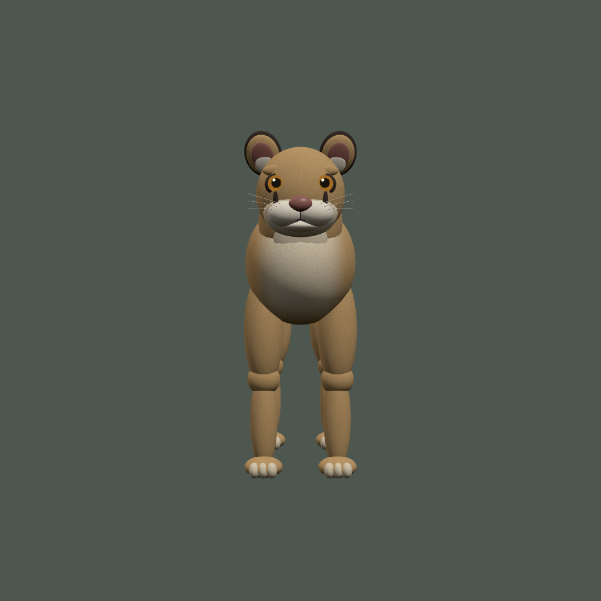
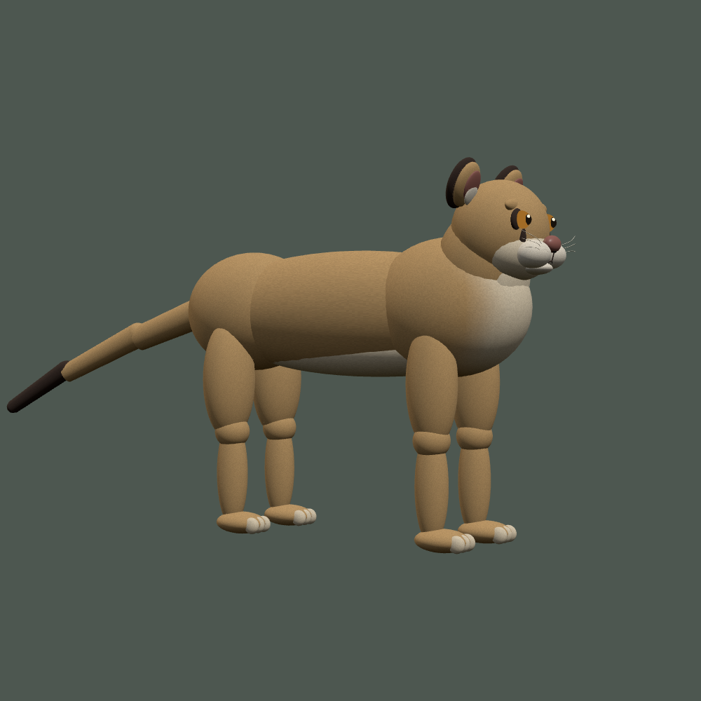
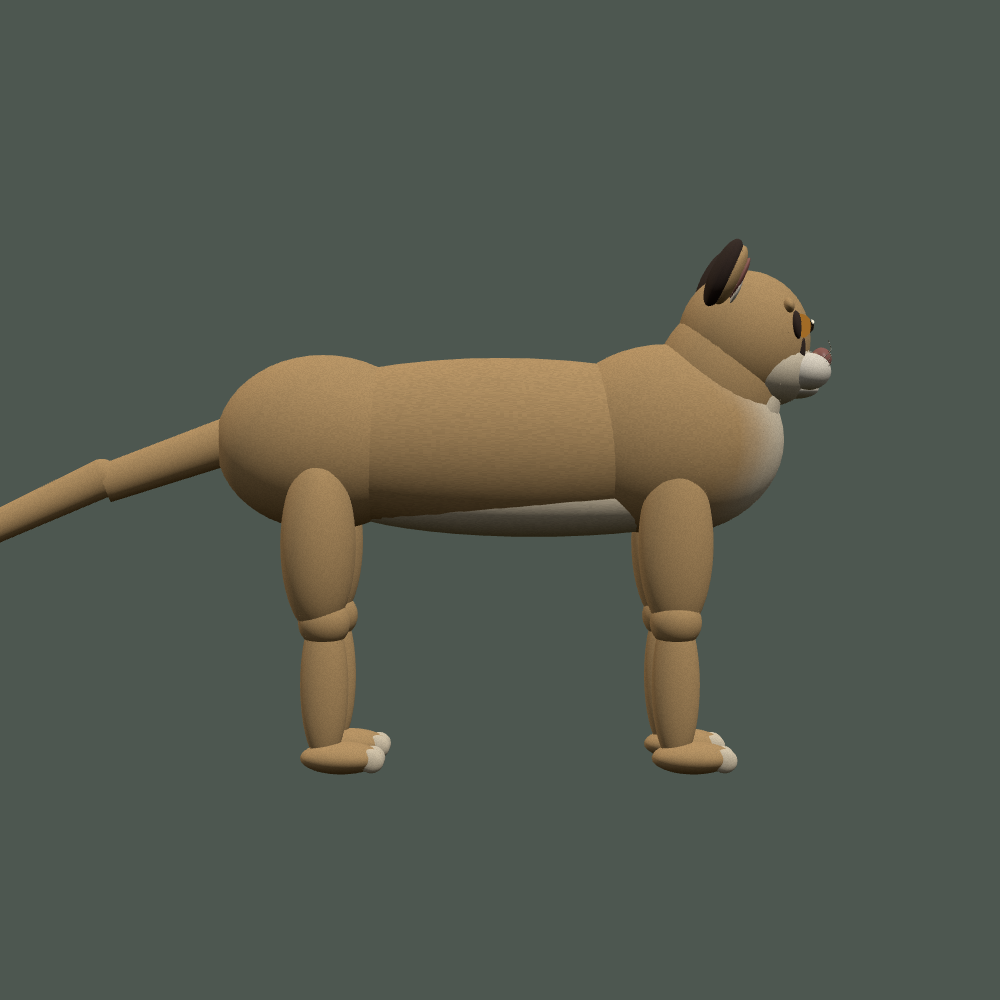
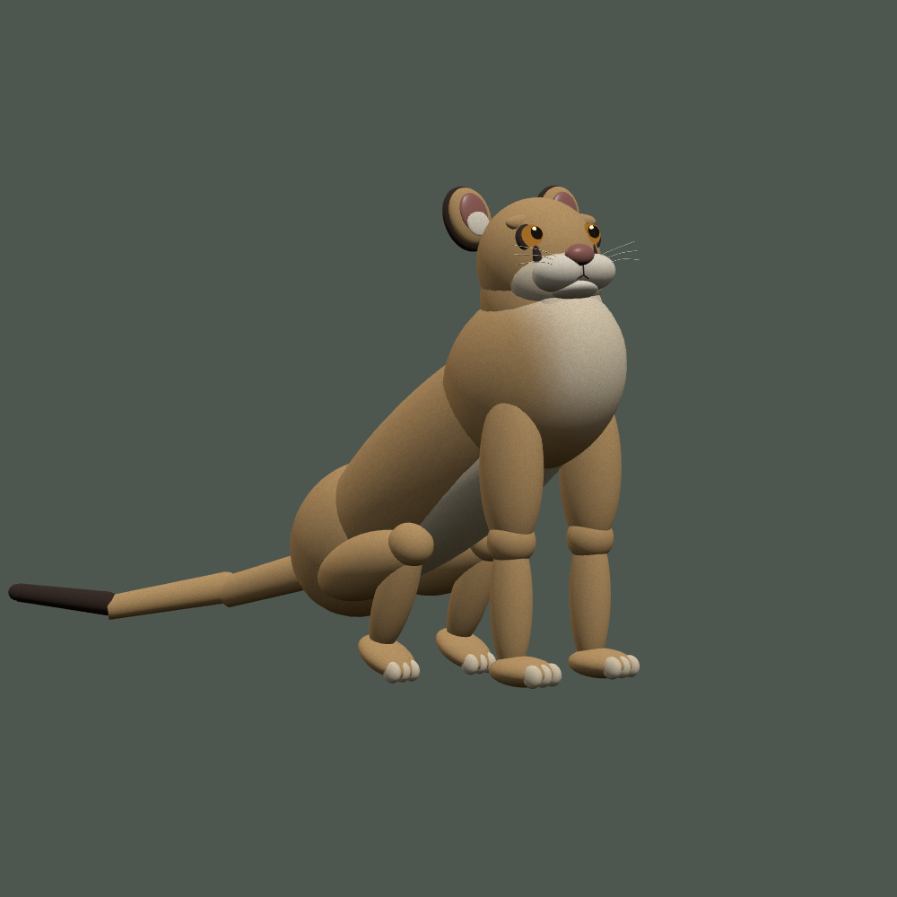

# Leão-baio (puma)

Modelo felino próprio inspirado na referência: pelagem dourada com microtextura, peito e focinho claros, nariz rosado, bigodes finos, olhos castanhos com reflexos, orelhas arredondadas com verso escuro, patas largas e cauda longa com ponta escura. Corpo, pescoço e cabeça têm proporções próprias de felino. O acabamento é estilizado, não fotográfico.

Mantém as quatro pernas com quadril/joelho/pata, cabeça e pescoço articulados, orelhas independentes, três articulações na cauda e reflexo dos olhos à noite. Postura neutra e de alerta ajustadas ao novo corpo. Continua caminhando, farejando, escutando, bebendo, alertando e fugindo. Sentar foi acrescentado como atividade ocasional, com duração de 4 a 8 segundos, preservando a reação a visitantes.

Na pose sentada, a altura do corpo foi ajustada para apoiar as patas dianteiras; as pernas traseiras dobram e a cauda se curva junto ao chão. A rotina específica usa o mesmo relógio de animação da fauna, inclusive ao pausar o mundo. Materiais e texturas são próprios por animal e liberados na remoção.

## Validação

21 testes unitários passaram: anatomia, articulações, geometria/normais finitas, patas apoiadas, isolamento de materiais e pose sentada sem acumular giro na cauda. Os testes do graxaim também passaram.

No bundle completo: criação pelo gerenciador real de fauna; caminhada, farejo, sentar, escutar e beber; alerta e fuga; movimento das pernas; matrizes finitas e remoção do modelo, sem erros JavaScript. Capturas abaixo renderizadas pelo código do jogo.

## Prints

| Frente | Três quartos | Perfil |
|---|---|---|
|  |  |  |

