# Turistas, celular e trilha sonora

Atualização na branch `codex/personagens-mais-realistas`.

Os turistas receberam mochilas com bolsos, alças e fechos, chapéus arredondados, gorros, coletes acolchoados, câmeras e uma paleta de passeio. Adultos e crianças mantêm proporções diferentes. A renderização continua usando instâncias para grupos de visitantes. Os modelos continuam estilizados, com geometria procedural; as referências orientam roupa e acessórios.

No celular, ficam visíveis direcional, ações e acesso ao menu. Mapa, missões, viagem, personagens, câmera, clima, música e ajuda ficam no menu. Os controles se ajustam às duas orientações. Abrir o menu ou perder o foco libera os comandos pressionados.

## Antes e depois

| Alteração | Antes | Depois |
|---|---|---|
| Turistas, frente | 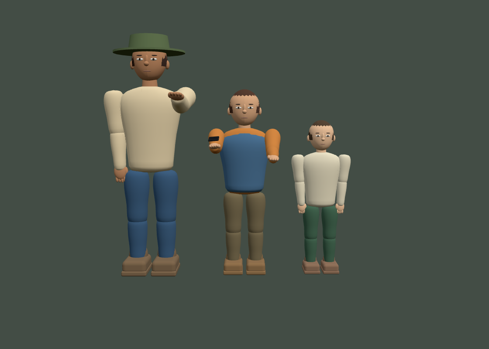 | 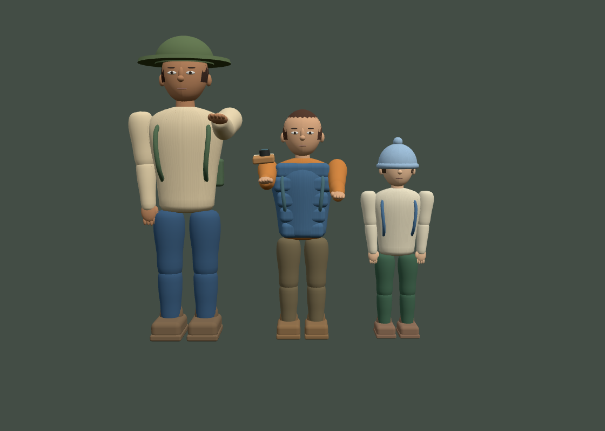 |
| Turistas, costas | 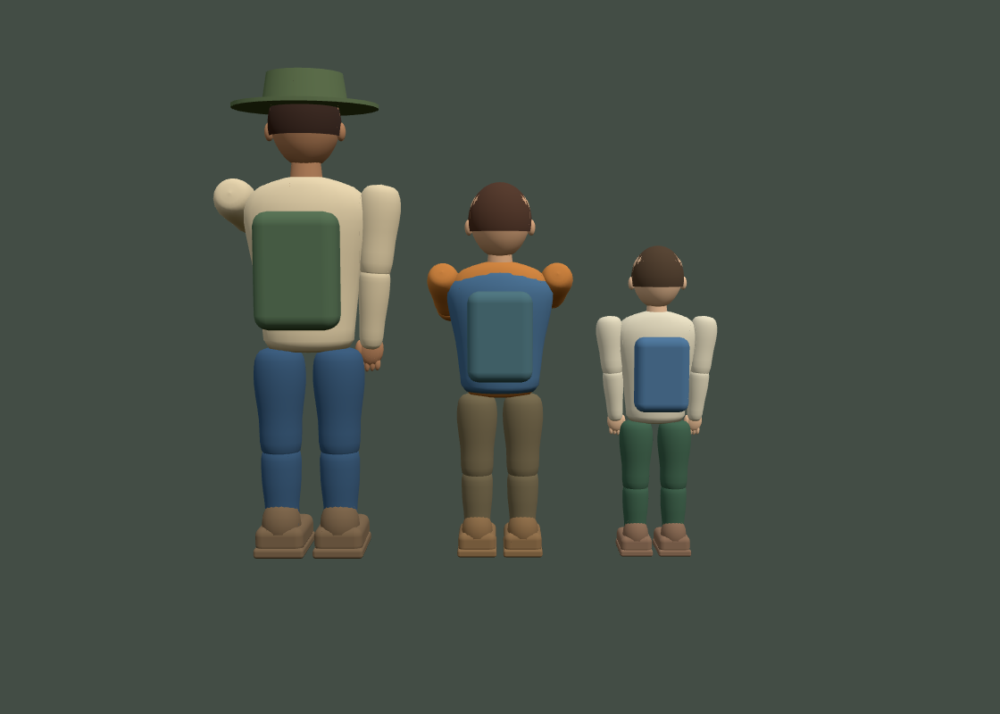 | 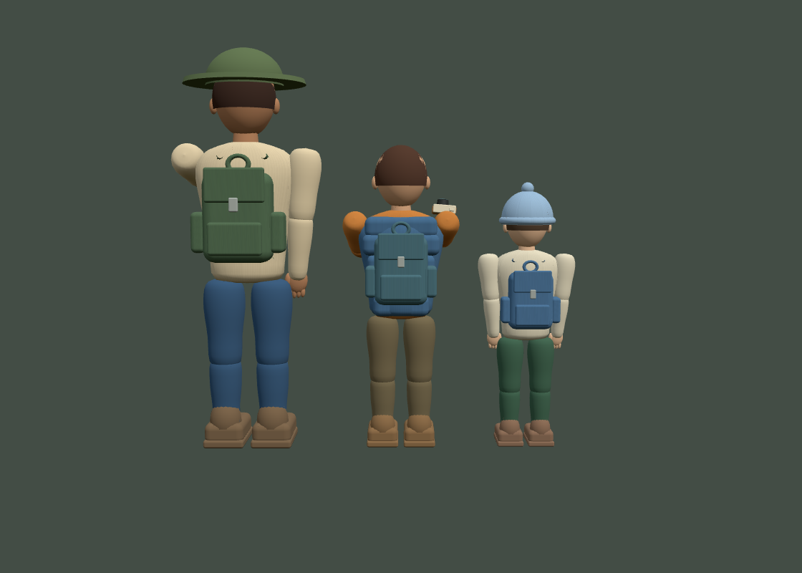 |
| Celular, paisagem | 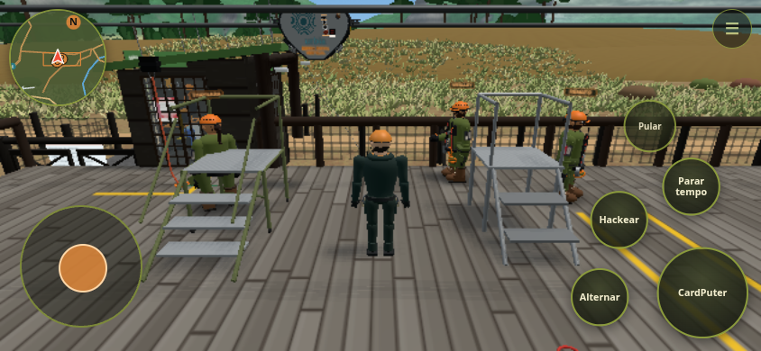 | 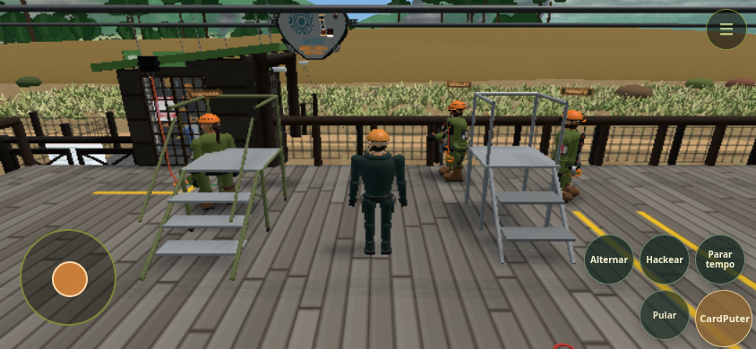 |
| Celular, retrato | 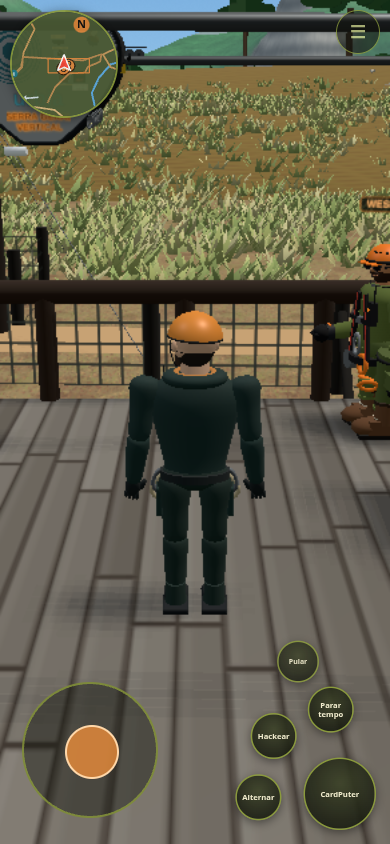 | 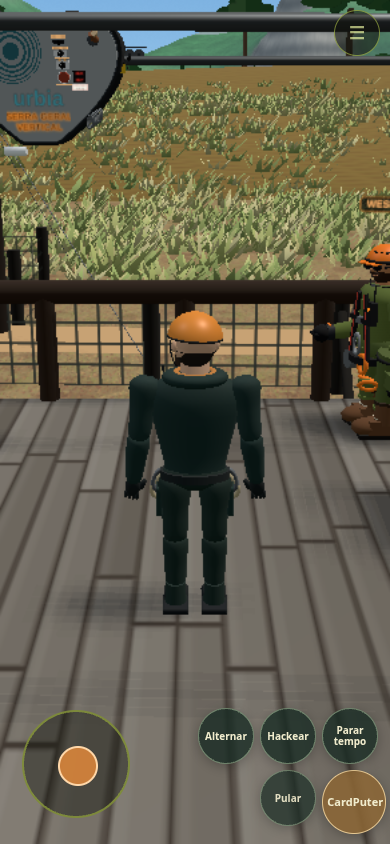 |
| Menu durante o jogo | 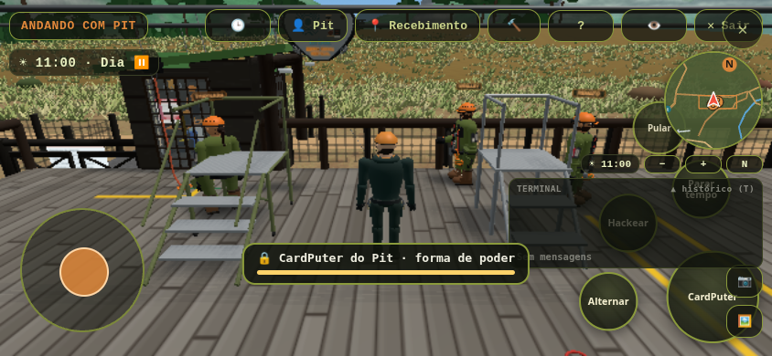 | 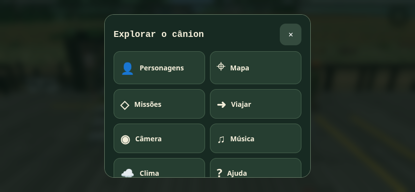 |
| Menu inicial | 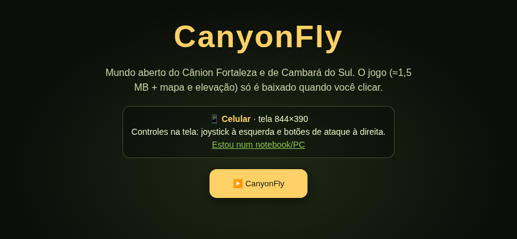 | 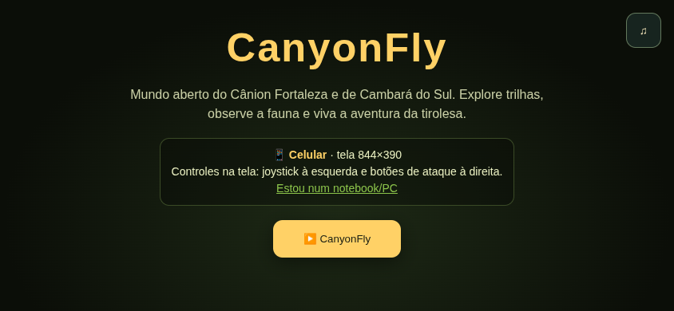 |

As imagens de turistas usam o renderizador real do jogo em estúdio, com as mesmas poses para comparação. As telas mobile são capturas do jogo em Chromium com toque emulado.

## Músicas

Os seis arquivos enviados foram preservados. A duração real dos arquivos difere de algumas estimativas do pedido.

| Faixa | Uso | Duração do arquivo | Loop |
|---|---|---|---|
| [Ambiente](../audio/ambiente.mp3) | Menu, recebimento, campo e mata durante o dia | 4:00 | Sim |
| [Tirolesa](../audio/tirolesa.mp3) | Lançamento até a chegada | 1:58 | Não |
| [Personagens](../audio/personagens.mp3) | Seleção e início da transformação | 1:55 | Sim |
| [Sepé](../audio/sepe.mp3) | Desbloqueio e personagem em cena | 1:54 | Sim |
| [Tupã](../audio/tupa.mp3) | Raio na Sequoia Lunar e personagem em cena | 2:00 | Sim |
| [Terror](../audio/terror.mp3) | Mata à noite, Anhangá e Gritador | 2:00 | Sim |

Transição de 1,6 segundo entre faixas. Cenas de descida e aparições têm prioridade sobre seleção e ambiente. A faixa de terror prevalece sobre o tema do personagem durante o perigo. Volume e silêncio são salvos no navegador; a reprodução começa após um toque ou tecla e pausa com a aba oculta. O loop repete o MP3 original, sem alterar sua composição.

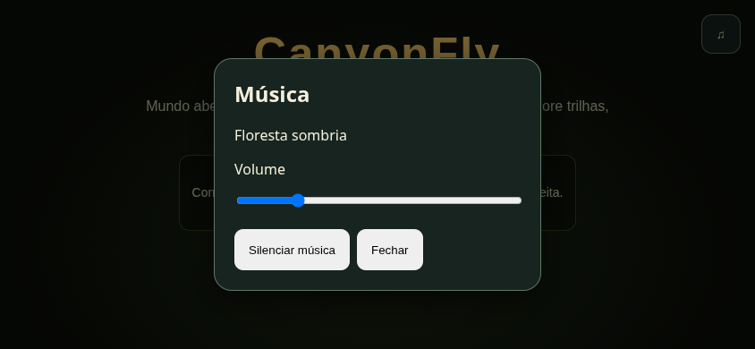

## Verificação

- Build do bundle e 26 testes automatizados.
- Regressão dos poderes dos 11 personagens, recargas e comandos por toque.
- Reprodução real dos seis MP3 no navegador, loops, volume, silêncio e retomada.
- Menu, ajuda e tamanho/posição dos botões em 844×390 e 390×844.
- [Registro da reprodução](media/revisao/depois/verificacao.json).

Scripts: `t3d/test/browser/revisao-mobile.cjs` captura as telas; `t3d/test/browser/musica-mobile.cjs` verifica áudio e interface. Precisam de um servidor HTTP na raiz (padrão porta 8020) e Chromium instalado.

## Entregas anteriores desta sequência

[Personagens](PERSONAGENS-REALISMO.md), [Pit](pit.md), [Jackão](jackao.md), [Krig sem chifres](krig.md), [Mohr](mohr.md), [Mary](mary.md), [Diully](diully.md), [Kauling](kauling.md), [Carlão](carlao.md), [Graxaim](graxaim.md), [Puma](puma.md) e [Cânion Fortaleza](fortaleza.md) têm seus registros e capturas nas páginas correspondentes.
