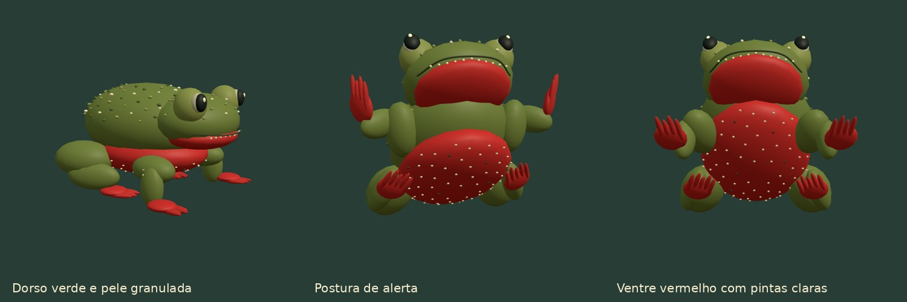

# Sapinho-verde-de-barriga-vermelha

Modelo procedural em 3D de **Melanophryniscus cambaraensis**, baseado nas referências fornecidas e adaptado ao estilo do jogo.

- Dorso verde-oliva, com pequenos relevos e pintas claras.
- Ventre, garganta, palmas e plantas dos pés vermelhos, com pintas claras no ventre.
- Corpo achatado e arredondado, focinho curto, olhos salientes com reflexos, quatro dedos nas mãos e cinco nos pés.
- Pernas dianteiras curtas e coxas posteriores dobradas; passos, pulinhos, piscadas e movimento da cabeça.
- Na postura de alerta existente, o corpo se arqueia e as patas sobem para mostrar as superfícies vermelhas.
- Comprimento nominal sorteado entre **3 e 4 cm** no mundo, sem aplicar a ampliação visual genérica dos outros sapinhos. As capturas são aproximações para mostrar os detalhes.

O nome foi atualizado na configuração da espécie, na galeria e na dica de fotografia. O identificador `cambaraensis` permanece compatível com as fotos salvas. Os comportamentos de casais, turfeiras, bordas e arroio são preservados. A outra espécie de sapinho e as pererecas mantêm seus modelos existentes.

## Verificação

- `npm --prefix t3d test`: inclui atributos finitos, cores e superfície granulada, animação de alerta e passos, nascimentos na escala configurada, integração e limpeza das instâncias.
- `npm --prefix t3d run build`: atualiza o bundle distribuído.
- `node t3d/test/browser/cambaraensis.cjs`: renderiza dorso, alerta, ventre e casal com o modelo real do jogo e verifica erros JavaScript. Aceita `PLAYWRIGHT_CHROMIUM_EXECUTABLE`.

O modelo usa sete partes instanciadas, com capacidade para a população configurada e sua reserva. As pintas e os relevos têm posições fixas, evitando gerar geometria durante a animação.
