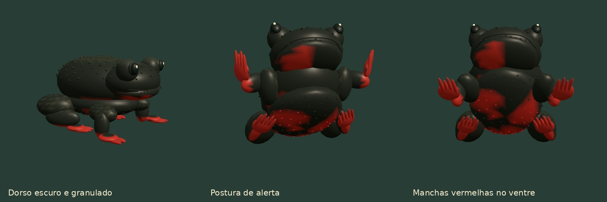

# Sapinho-de-barriga-vermelha

Modelo procedural em 3D de **Melanophryniscus dorsalis**, baseado nas referências fornecidas e adaptado ao estilo do jogo.

- Dorso muito escuro, com relevo granulado e brilho discreto.
- Ventre com manchas vermelhas irregulares separadas por pele escura; vermelho também na garganta e nas extremidades das patas.
- Olhos salientes escuros, corpo arredondado, membros curtos e dedos separados.
- Passos, pulinhos, piscadas e postura de alerta que levanta as patas para mostrar as superfícies vermelhas.
- Comprimento nominal de 2 a 3 cm no mundo. As imagens são aproximações para mostrar os detalhes.

A antiga listra amarela genérica foi removida. O sapinho-verde-de-barriga-vermelha (*M. cambaraensis*) mantém sua coloração verde e o ventre vermelho com pintas claras. As duas espécies compartilham a estrutura de animação e usam geometrias, cores e instâncias separadas. Pererecas mantêm o modelo existente.

O nome foi atualizado na configuração, galeria e dica de fotografia. O identificador `dorsalis` preserva as fotos e conquistas salvas. Os casais, habitats e comportamentos existentes são mantidos.

## Verificação

- `npm --prefix t3d test`: atributos finitos, ventre com áreas vermelhas e escuras, diferença entre espécies, animação e coexistência com pererecas, escalas e limpeza das instâncias.
- `npm --prefix t3d run build`: gera o bundle distribuído.
- `node t3d/test/browser/dorsalis.cjs`: quatro capturas reais do renderizador, sem erros JavaScript. Aceita `PLAYWRIGHT_CHROMIUM_EXECUTABLE`.

A geração das geometrias ocorre na criação do modelo. Sete partes instanciadas representam os sapinhos sem gerar novas superfícies durante a animação.
